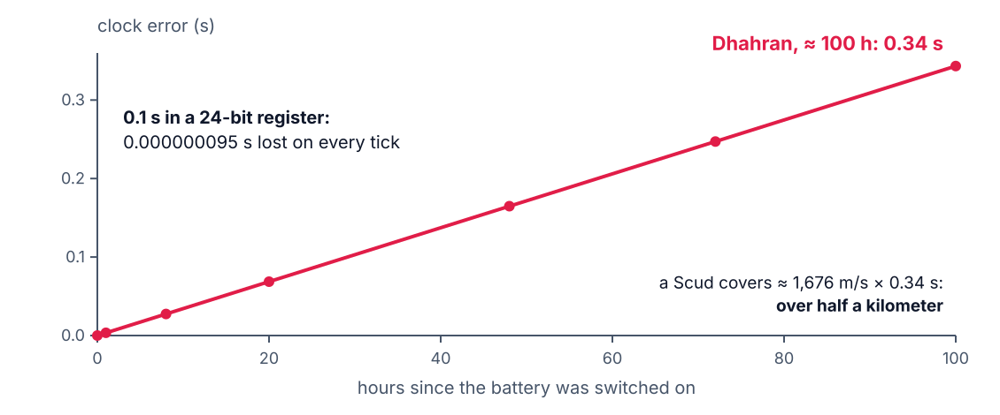
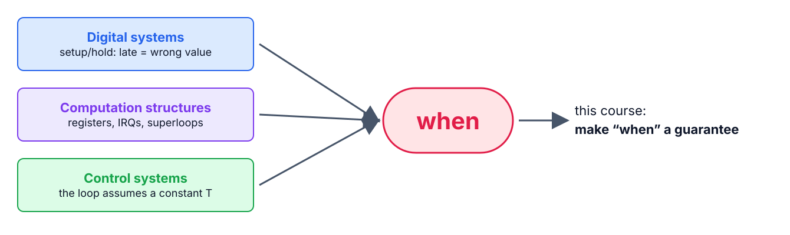
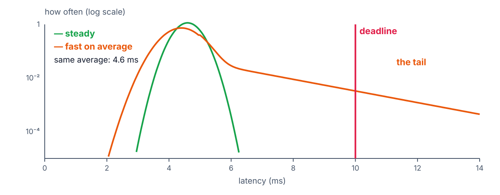

<!--
theme: course
paginate: true
title: Why real-time
style: |
  section { --course: #0d9488; }
-->

<!-- _class: lead -->
<!-- _paginate: false -->

# Why real-time

**Week 1** · the recap that converges on *when*, and the course

A correct result at the wrong time is a wrong result.

<!--
0:00–1:00. Welcome. One sentence on what the semester builds: an irrigation
controller whose deadlines are set by physics, measured at every step.
-->

---

<!-- _class: agenda -->

## Today

1. **The Patriot clock**: correct code, wrong time
2. **Convergence**: three courses you took, one word
3. **What real-time is**: predictable, not fast
4. **The course**: GreenField, the RET, the grade
5. **The toolchain**: Zephyr, two boards, FreeRTOS on the side
6. **Lab**: your environment, timed

Goal: explain why a late result is a wrong one, citing a real failure.

<!--
1:00–2:00. Reading for the week: Buttazzo §1.1–1.2.
-->

---

<!-- _class: s1 figure -->
<!-- _header: 1 · The Patriot clock -->

## Dhahran, 25 February 1991: the clock drifted with uptime

<!--
2:00–5:00. GAO/IMTEC-92-26, retold in Buttazzo §1.2. The Patriot counted time in
tenths of a second; 0.1 has no exact binary form, and the 24-bit register chopped
it, losing about 0.000000095 s per tick. After 100 hours of continuous operation
the clock was 0.34 s off, and the range gate looked in the wrong place: no
intercept, 28 soldiers killed in the barracks. GAO's own table puts the range-gate
shift at 687 m. Every computation was correct; the system failed in the dimension
nobody tested.
Second story, 30 seconds: STS-1, 10 April 1981, the first Shuttle launch scrubbed
by a timing race between the backup and primary computers at initialization, about
a 1-in-67 chance (Garman, "The BUG heard 'round the world").
-->

---

<!-- _class: s1 question -->
<!-- _header: 1 · The Patriot clock -->

## Would a faster CPU have saved Dhahran?

1. Yes: it would have computed the range gate in time
2. No: the error grew with uptime, not with load
3. Yes: the tracking math fell behind under heavy radar traffic
4. No: the Scud was out of range

<!--
5:00–6:30. Vote, one minute in pairs, vote again. Answer: 2. The system met every
throughput requirement; the bug was in how time was represented and accumulated.
1 and 3 are the "real-time means fast" misconception the next segment takes apart.
-->

---

<!-- _class: s2 figure -->
<!-- _header: 2 · Convergence -->

## You already own the three pieces

<!--
6:30–14:00. Name each in their language.
Digital systems: setup and hold, FSMs, timing diagrams. A flip-flop that latches
late holds a wrong value; hardware already signs timing contracts.
Computation structures: registers, the vector table, polling vs. interrupts on the
STM32. They have written superloops; they never measured one.
Control: a discrete controller is derived for a constant sampling period. Every
formula they used assumes the software delivers samples on time. Jitter is a
disturbance their control course never modeled.
-->

---

<!-- _class: s3 -->
<!-- _header: 3 · What real-time is -->

## Correct, and on time

> A real-time system is one whose correctness depends on the logical result **and on the time** at which it is produced. (Buttazzo §1.1)

- Real-time is not *fast*: it is a worst case that is **bounded and proven**
- "Real-time analytics" on a web dashboard means *usually quick*; here it means *always on time*

<!--
14:00–16:00. Write the definition on the board and leave it there all semester.
-->

---

<!-- _class: s3 figure -->
<!-- _header: 3 · What real-time is -->

## Same average, different verdict

<!--
16:00–20:00. Two latency distributions with the same mean (illustrative). Read the
y axis: log scale, the way every latency histogram in this course is read. The
orange one is faster most of the time and still misses the deadline; the green one
never does. Label the tail: "what this course hunts".
Misconception to anticipate: "real-time means fast". The deadline line doesn't
care about the mean.
-->

---

<!-- _class: s3 question -->
<!-- _header: 3 · What real-time is -->

## A controller averages 2 µs, with a rare 20 ms spike. Deadline: 10 ms. Is it real-time?

1. Yes: the average is far below the deadline
2. No: its worst case misses the deadline
3. Yes, if the spike is rarer than one in a million
4. It depends on the CPU

<!--
20:00–22:00. Answer: 2, for a hard deadline. 3 is the soft real-time answer, and it
is a design decision someone must write down, not a default. 4 dodges the question:
the measurement already answered it. Then: which one ships in a ventilator?
-->

---

<!-- _class: s4 -->
<!-- _header: 4 · The course -->

## GreenField Technologies, Control Systems team

- You join as firmware engineers: SoilSense already **measures**, your team makes it **act**
- Actuation has deadlines set by physics: a valve that closes late bursts a hose
- The **RET** (Timing Evidence Report): every timing claim cites a measurement
- House rule: **"show me the trace"**

| Labs, weeks 1–10 | Project, weeks 11–14 |
|---|---|
| 30 % | 70 % |

<!--
22:00–27:00. The briefing is PROJECT_SCENARIO.md. The workshop (week 7) is a
design review with an individual quiz; it counts as one of the labs. The project is
the SoilSense Hub on PREEMPT_RT Linux, linked to the nodes over CAN.
-->

---

<!-- _class: s5 -->
<!-- _header: 5 · The toolchain -->

## One toolchain, three boards

| Weeks | Board | Why |
|---|---|---|
| 1–2 | NUCLEO-L476RG | yours already; the baseline |
| 3–9 | ESP32-S3 | the product's chip, two cores |
| 10–16 | Raspberry Pi 4, PREEMPT_RT | the Hub |

- Zephyr: `west`, CMake, devicetree (hardware as data; week 3 shows why)
- `native_sim` for logic, never for timing numbers
- FreeRTOS in every lab, as the comparison; week 8 is its session

<!--
27:00–32:00. The Zephyr version is pinned for the semester in west.yml: everyone,
and the CI, builds the same tree.
-->

---

<!-- _class: takeaway -->

## The one thing to remember

> A correct result at the wrong time is a wrong result. This course makes *when* a guarantee, and proves it with measurements.

<!--
32:00–33:00.
-->

---

<!-- _header: Lab -->

## Today in the lab

| Predict now | Then measure |
|---|---|
| Edit → build → flash → console, seconds | the full cycle, pristine |
| The same, one line changed | the incremental build |

Then: blinky on every member's laptop, and the team RET created.

<!--
33:00–36:00. If the environment works, the semester's iteration loop is under a
minute, and every later measurement stands on that loop.
-->

---

## References

- Buttazzo, *Hard Real-Time Computing Systems*, 4th ed., §1.1–1.2
- GAO, *Patriot Missile Defense: Software Problem Led to System Failure at Dhahran*, GAO/IMTEC-92-26, 1992
- J. Garman, "The BUG heard 'round the world", *ACM SIGSOFT SEN* 6(5), 1981
- Optional: Lee & Seshia, *Introduction to Embedded Systems*, ch. 1 (free at leeseshia.org)

<!--
36:00–40:00. Questions; the references slide stays up while the lab starts.
-->
