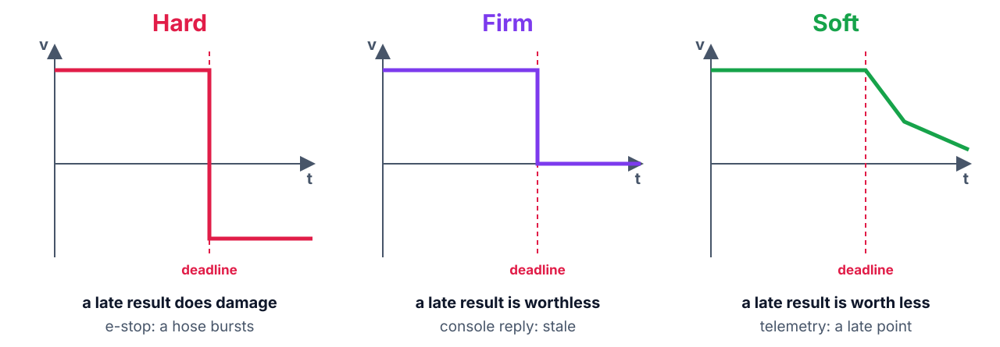
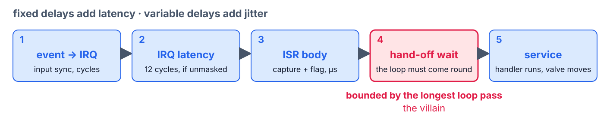

<!--
theme: course
paginate: true
title: The vocabulary
math: mathjax
style: |
  section { --course: #0d9488; }
-->

<!-- _class: lead -->
<!-- _paginate: false -->

# The vocabulary

**Week 2** · taxonomy, task models, latency anatomy

Before you pitch a kernel, measure what we already have.

<!--
0:00–2:00. Samuel's memo: the superloop is the architecture this company knows how
to maintain. Today's words are the ones the baseline table is written in.
-->

---

<!-- _class: agenda -->

## Today

1. **Taxonomy**: hard, firm, soft, by what a miss costs
2. **Task model**: T, C, D, R, and jitter
3. **Latency anatomy**: the chain from event to response
4. **Requirements**: sentences a test can fail
5. **Lab**: the baseline

Goal: classify a task by the cost of a miss, and write its requirement in EARS.

<!--
2:00–3:00. Reading: Buttazzo §1.3, §2.1–2.3.
-->

---

<!-- _class: s1 figure -->
<!-- _header: 1 · Taxonomy -->

## What a result is worth, by when it arrives

<!--
3:00–7:00. Buttazzo §2.2: the value function v(t). Hard: past the deadline the
value is negative, damage. Firm: it drops to zero, useless but harmless. Soft: it
decays, late still helps. Under each, the node task that plays it.
-->

---

<!-- _class: s1 question -->
<!-- _header: 1 · Taxonomy -->

## Sampling only reads a pressure sensor. What type is it?

1. Soft: a late sample is still a sample
2. Firm: a late sample is useless
3. Hard: its jitter corrupts the control loop
4. Not real-time: nothing reacts to it

<!--
7:00–9:00. Classify the scenario's five tasks first, then this vote. Answer: 3.
Sampling feels soft, but the control law assumes it happens on time: its jitter
poisons the loop, and the loop is hard. 1 and 2 judge the task alone, not what
depends on it.
-->

---

<!-- _class: s2 -->
<!-- _header: 2 · Task model -->

## The variables of the semester

| Symbol | Meaning |
|---|---|
| $T_i$ | period |
| $C_i$ | computation time, **measured** |
| $D_i$ | relative deadline (often $= T_i$) |
| $R_i$ | response time: finish − release |
| jitter | how much any of these varies |

<!--
9:00–13:00. Buttazzo §2.1, §4.1. R_i is the star of week 6. The lab measures
period jitter first.
Misconception to anticipate: "jitter averages out". For a control loop the worst
sample is the one that hurts; that is why every table in this course asks for max.
-->

---

<!-- _class: s3 figure -->
<!-- _header: 3 · Latency anatomy -->

## One flow pulse, five delays

<!--
13:00–19:00. Walk it left to right. 1: the input synchronizer, cycles. 2: the
Cortex-M4 takes 12 cycles to enter an exception if nothing masks it; long
irq_lock sections stretch it. 3: the ISR captures and sets a flag, µs. 4: the flag
waits until the loop comes round: bounded by the slowest task's worst pass, the
villain. 5: the handler runs.
The L4's ART cache makes links 1–3 wobble (0 or 4 wait states per fetch), so the
lab measures twice, cache on and off: the difference isolates them. What survives
is link 4. Buttazzo §2.4 catalogs the rest (DMA, caches, interrupts, syscalls);
week 8 returns to it.
-->

---

<!-- _class: s3 question -->
<!-- _header: 3 · Latency anatomy -->

## The `calib` command spins for 400 ms. Which link does it stretch?

1. Link 2: it masks interrupts
2. Link 3: the ISR runs longer
3. Link 4: the flag waits for the loop to come round
4. Link 5: the handler runs slower

<!--
19:00–21:00. Answer: 3. The ISR still fires and still sets its flag; nobody serves
the flag until calib returns. They measure it in an hour: 400 ms of jitter, and
backlog_peak counting the ticks that piled up.
-->

---

<!-- _class: s4 -->
<!-- _header: 4 · Requirements -->

## A requirement is a sentence a test can fail

EARS (Mavin et al., 2009, from jet-engine control at Rolls-Royce):

- **While** ⟨state⟩, the system shall ⟨response⟩ **within** ⟨deadline⟩
- **When** ⟨event⟩, the system shall ⟨response⟩ **within** ⟨deadline⟩

One condition, one response, one number, one ID: `REQ-CTRL-01`.

<!--
21:00–26:00. State-driven ≈ periodic tasks, event-driven ≈ aperiodic: the grammar
mirrors the task model. Live rewrite on the board with the class: "sampling must
be fast and regular" becomes "While irrigating, the system shall sample pressure
every 1 ms with jitter below X µs", where X is what the lab measures today.
Requirements and baselines are born together.
Misconception to anticipate: "requirements are paperwork". From today every piece
of evidence cites one; that is what makes week 7's defense possible. Don't say
"RTM" yet: that name is week 7's reveal.
-->

---

<!-- _class: s4 question -->
<!-- _header: 4 · Requirements -->

## Which one is a requirement?

1. The valve shall respond quickly to overpressure
2. When pressure exceeds the threshold, the system shall close the valve within 5 ms
3. The e-stop shall have the highest priority
4. The system shall be real-time

<!--
26:00–28:00. Answer: 2, and it is exactly the one they need in Task D. 1 has no
number; 3 is a design decision, not a requirement; 4 can't fail any test.
-->

---

<!-- _class: s4 -->
<!-- _header: What about FreeRTOS? -->

## What about FreeRTOS?

- Nothing today belongs to Zephyr: taxonomy, task model, latency chain and EARS apply under FreeRTOS or bare metal
- The vocabulary is the asset that transfers

<!--
28:00–29:00.
-->

---

<!-- _class: takeaway -->

## The one thing to remember

> Fixed delays add latency; variable delays add jitter. Ask for the **max**, never the mean.

<!--
29:00–30:00.
-->

---

<!-- _class: s5 -->
<!-- _header: 5 · Lab -->

## Today in the lab

| Predict now | Then measure |
|---|---|
| Max sampling jitter, idle | ≥ 30 s on the analyzer |
| The same, flash cache off | the ART's contribution |
| The same, during `calib` | link 4, stretched |
| `backlog_peak` during `calib` | the same story, in ticks |

<!--
30:00–34:00. Expect µs-level jitter until the blocking command turns it into ms.
That number is the course baseline: everything after week 2 is measured against it.
-->

---

## References

- Buttazzo, §1.3 and §2.1–2.3; §2.4 skimmed (returns in week 8)
- A. Mavin et al., "Easy Approach to Requirements Syntax (EARS)", *IEEE RE'09*
- J. Yiu, *The Definitive Guide to ARM Cortex-M3 and Cortex-M4 Processors*, 3rd ed., ch. 8 (exception entry)
- STM32L4 reference manual RM0351: EXTI, NVIC, and §3.3 (the ART accelerator)
- Zephyr docs: *Interrupts*

<!--
34:00–40:00. Questions, then the lab.
-->
