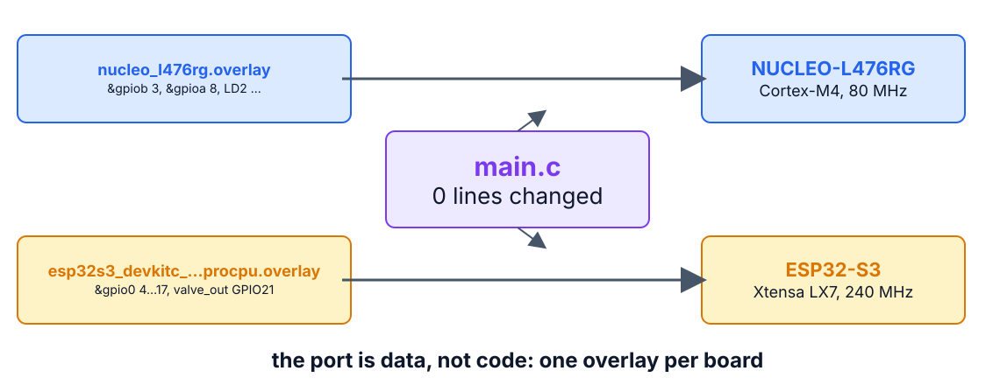
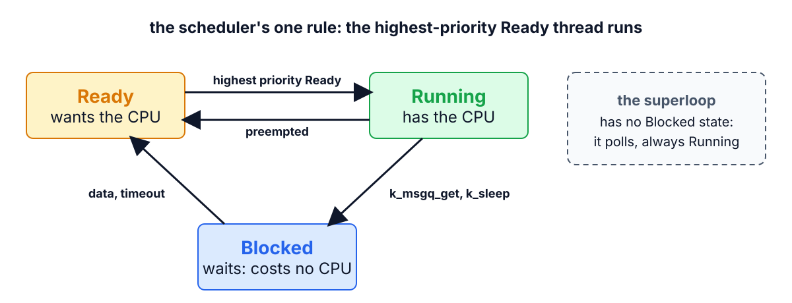
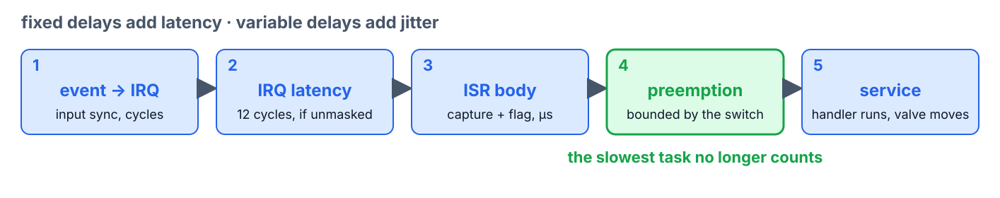

<!--
theme: course
paginate: true
title: The scheduler
style: |
  section { --course: #0d9488; }
-->

<!-- _class: lead -->
<!-- _paginate: false -->

# The scheduler

**Week 3** · the port, threads, priorities, preemption

Production picked the ESP32-S3, and the kernel evaluation is authorized.

<!--
0:00–2:00. Samuel's two pieces of news. First the port, without rewriting
anything; then the first thread.
-->

---

<!-- _class: agenda -->

## Today

1. **The port**: hardware as data
2. **The kernel**: threads, states, one rule
3. **The first mapping**: polled sampling becomes a thread
4. **FreeRTOS**: same model, no devicetree
5. **Lab**: the diff-stat and the new jitter

Goal: explain what an overlay buys a port, and why a blocked thread costs nothing.

<!--
2:00–3:00. Reading: Buttazzo §10.1–10.3.
-->

---

<!-- _class: s1 figure -->
<!-- _header: 1 · The port -->

## One program, two boards, two overlays

<!--
3:00–8:00. The application names hardware by role; a separate description binds
the role to pins. Vocabulary, one line each: node (a device in the tree),
property (its facts), binding (the schema a node must follow), alias and chosen
(role names the app looks up: led0, zephyr,console), overlay (a patch on the
board's tree: this is the port). Zephyr compiles the tree: DEVICE_DT_GET resolves
at build time and costs no RAM; Linux parses the same syntax at boot (week 10's
SBC).
Today students write the S3 overlay from the Nucleo one. Warn them: without it the
build still succeeds, because every pin is optional. Flat lines on the analyzer
mean a misnamed file.
-->

---

<!-- _class: s2 figure -->
<!-- _header: 2 · The kernel -->

## Three states and one rule

<!--
8:00–13:00. Buttazzo §10.1–10.3. A thread is a stack, saved registers and a TCB
(priority, state); the superloop had one implicit thread. The scheduler's rule is
enforced at every preemption point: an ISR returns, a mutex unlocks, a sleep
expires. "Immediately" replaces "when the loop comes round".
-->

---

<!-- _class: s2 -->
<!-- _header: 2 · The kernel -->

## Switching costs something, and so does priority 0

- Context switch: save one thread's registers, restore another's. Cortex-M rides the PendSV exception; the S3's Xtensa core spills register windows instead
- Zephyr: **lower number, more important**; negative priorities are cooperative
- `main` is a thread at priority 0. A superloop `main` never blocks, so nothing at 0 or below would ever run: `CONFIG_MAIN_THREAD_PRIORITY=10`

<!--
13:00–17:00. The switch costs about a microsecond on the S3: measured, not
believed, in week 4's Task C. Yiu ch. 10 has the Cortex-M sequence register by
register.
Misconception to anticipate: "the kernel adds overhead, so it's slower". Slower on
average by µs of switching; but the worst case stops depending on the longest loop
body. Week 4's A/B shows both in one table.
-->

---

<!-- _class: s2 figure -->
<!-- _header: 2 · The kernel -->

## Last week's chain, with a scheduler

<!--
17:00–19:00. Link 4 used to be "until the loop comes round". With preemption it
becomes the switch cost: bounded, and independent of what the other tasks do.
-->

---

<!-- _class: s2 question -->
<!-- _header: 2 · The kernel -->

## Sampling runs at priority 2, the console at 9. What does `calib` do to sampling now?

1. Delays it by 400 ms, as in the superloop
2. Delays it by one context switch, at most
3. Nothing until `calib` yields the CPU
4. Starves it: the console never blocks

<!--
19:00–21:00. Ask for the prediction out loud, then vote. Answer: 2. 3 describes a
cooperative scheduler; 4 forgets that preemption doesn't need the console's
consent. This afternoon's measurement settles it.
-->

---

<!-- _class: s3 -->
<!-- _header: 3 · The first mapping -->

## Only sampling moves today

| Superloop | Kernel |
|---|---|
| tick ISR raises a flag | tick ISR posts its release time to `tick_q` (`k_msgq`) |
| loop polls the flag | `sampling_thread` blocks on `k_msgq_get` |
| every 10th tick: control | every 10th sample: a flag for the loop |

Everything else stays in the superloop: that is how real products migrate.

<!--
21:00–26:00. The timestamp in the queue lets the thread measure its own release
latency: lat_peak_us. Control still lives in the loop.
-->

---

<!-- _class: s3 question -->
<!-- _header: 3 · The first mapping -->

## Control still lives in the loop. What does `calib` do to it this afternoon?

1. Nothing: sampling raises its flag on time
2. It still stalls: the flag waits for the loop
3. It runs early: the flag fires twice
4. It moves to the sampling thread

<!--
26:00–28:00. Answer: 2. The flag is raised on time; the loop that serves it is
stuck in calib. They measure both on the same screen; week 4 finishes the job.
-->

---

<!-- _class: s4 -->
<!-- _header: What about FreeRTOS? -->

## What about FreeRTOS?

- `xTaskCreate` ↔ `K_THREAD_DEFINE`, `xQueueSend`/`Receive` ↔ `k_msgq_put`/`get`: same preemptive fixed-priority model
- One habit flips: FreeRTOS priorities count **up**, Zephyr's down
- No devicetree: moving STM32 → ESP32 means changing vendor SDK, not writing an overlay

<!--
28:00–30:00.
-->

---

<!-- _class: takeaway -->

## The one thing to remember

> The highest-priority Ready thread runs, always. A thread that blocks costs nothing; a loop that polls costs everything below it.

<!--
30:00–31:00.
-->

---

<!-- _class: s5 -->
<!-- _header: 5 · Lab -->

## Today in the lab

| Predict now | Then measure |
|---|---|
| Lines of C changed by the port | `git diff --cached --stat` |
| S3 idle max jitter vs. the L476's | the same protocol as week 2 |
| Sampling jitter during `calib`, with the thread | the third column |

<!--
31:00–35:00. Let them bet on clock vs. flash cache. For you: neither wins. The S3's
UART has a 128-byte TX FIFO, so the 1 Hz telemetry line is queued in ≈ 80 µs
instead of blocking ≈ 6 ms on the L476's one-byte USART. Clock and cache show up
in the C_i widths, not the max. calib is time-based: ≈ 400 ms on both.
-->

---

## References

- Buttazzo, §10.1–10.3 (§10.4–10.5 skipped)
- Zephyr docs: *Threads*, *Scheduling*, *Introduction to devicetree*
- J. Yiu, *The Definitive Guide to ARM Cortex-M3 and Cortex-M4 Processors*, 3rd ed., ch. 10 (PendSV)
- FreeRTOS docs: *Task states*

<!--
35:00–40:00. Questions, then the lab.
-->
