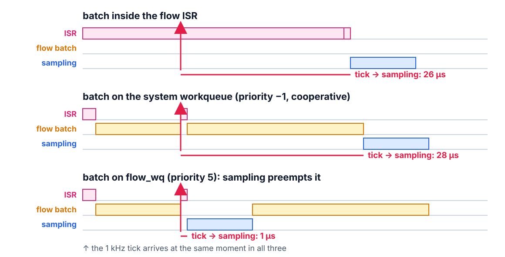

<!--
theme: course
paginate: true
title: IPC and deferral
style: |
  section { --course: #0d9488; }
-->

<!-- _class: lead -->
<!-- _paginate: false -->

# IPC and deferral

**Week 4** · message queues, semaphores, workqueues, short ISRs

The A/B table decides the product's architecture.

<!--
0:00–2:00. Samuel has to defend the table to Gustavo: same tasks, same board, same
protocol, one variable. Today's talk completes the mapping so the lab can finish
the migration.
-->

---

<!-- _class: agenda -->

## Today

1. **The mapping**: every superloop piece, its kernel counterpart
2. **Deferral**: short ISRs, and where the work goes
3. **Reading an A/B**: maxima, not averages
4. **FreeRTOS**: one-to-one, different defaults
5. **Lab**: the migration and the A/B

Goal: pick the right primitive for each superloop pattern, and read an A/B by its worst case.

<!--
2:00–3:00. Reading: Buttazzo §10.6–10.7.
-->

---

<!-- _class: s1 -->
<!-- _header: 1 · The mapping -->

## Migration is a table, not an art

| Superloop piece | Kernel counterpart |
|---|---|
| ISR flag + check in the loop | short ISR + `k_msgq` (carries data) or `k_sem` (only "go") |
| heavy polled work | a thread with its own priority |
| improvised bottom half | `k_work` on a workqueue of your own |
| console that blocks everything | a thread at the lowest priority |

<!--
3:00–8:00. Fill the right column with the class before revealing it. Each row
removes one coupling the superloop forced. k_msgq vs. k_sem: the queue carries the
tick's release time (week 3); the semaphore only wakes control every 10th sample.
Pick the lighter one when there is nothing to carry.
-->

---

<!-- _class: s1 -->
<!-- _header: 1 · The mapping -->

## Two rules the migration follows

- **Every thread blocks.** A thread that polls without sleeping owns every cycle below it, idle included. The console polls, then naps 5 ms
- **`main` brings the hardware up and returns.** At its default priority 0 it outranks every thread, so bring-up finishes before any of them runs

<!--
8:00–11:00. The S3's 128-byte RX FIFO holds ≈ 11 ms of typing at 115200, so a 5 ms
nap loses nothing. Last week's CONFIG_MAIN_THREAD_PRIORITY=10 goes away.
-->

---

<!-- _class: s1 question -->
<!-- _header: 1 · The mapping -->

## Which row ends the `calib` problem?

1. Short ISR + `k_msgq`: the tick is never lost
2. Heavy work in its own thread: control gets a priority
3. The console as the lowest-priority thread: it can be preempted
4. `k_work`: the batch leaves the loop

<!--
11:00–13:00. Answer: 3. calib still spins for 400 ms; it just no longer matters,
because every thread above it preempts it. The console isn't fixed, only
deprioritized. 2 is half of it: control's own thread only wins if the console sits
below it, which is row 4. 1 never was the problem.
-->

---

<!-- _class: s2 figure -->
<!-- _header: 2 · Deferral -->

## Where the flow batch runs decides how long the tick waits

<!--
13:00–19:00. Work done in an ISR is latency charged to every task. The rule: the
ISR captures and hands off in µs; a thread or a work item processes. The trap:
Zephyr's system workqueue runs at priority −1, cooperative, so nothing preemptive
can interrupt a work item there, sampling included. The lab starts its own queue at
priority 5 with k_work_queue_start. Durations are illustrative.
-->

---

<!-- _class: s2 question -->
<!-- _header: 2 · Deferral -->

## The flow batch is float math, with the FPU off. Submitted to the system workqueue, what does it do to sampling jitter?

1. Nothing: work items run in the background
2. Adds the whole batch, tens of µs on the S3
3. Adds one context switch
4. Nothing: the ISR already returned

<!--
19:00–21:00. Answer: 2. "Background" is the misconception: cooperative means
nobody preempts it. 3 is what flow_wq at priority 5 costs.
-->

---

<!-- _class: s3 -->
<!-- _header: 3 · Reading an A/B -->

## Same tasks, same board, same protocol; one variable

- Compare **maxima**: Samuel's question is the worst case
- Expect the averages nearly tied and the max under `calib` transformed
- Report the **cost** too: the switch gap, the stacks. An ADR that hides the cost won't convince Gustavo

<!--
21:00–26:00. Misconception to anticipate: "threads make the system faster". They
don't: switches cost. What they buy is a worst case that stops depending on
unrelated code.
-->

---

<!-- _class: s4 -->
<!-- _header: What about FreeRTOS? -->

## What about FreeRTOS?

- `k_msgq` → `xQueue`, `k_sem` → semaphores, `k_work` → the timer-daemon task or a worker of your own
- Same discipline, same table
- The difference is defaults: FreeRTOS boots minimal (its strength on small chips); Zephyr ships console, logging and shell ready

<!--
26:00–28:00.
-->

---

<!-- _class: takeaway -->

## The one thing to remember

> An ISR captures and hands off. The work goes to a thread, at a priority you chose, never to a queue nobody can preempt.

<!--
28:00–29:00.
-->

---

<!-- _class: s5 -->
<!-- _header: 5 · Lab -->

## Today in the lab

| Predict now | Then measure |
|---|---|
| Max sampling jitter during `calib` | the A/B against week 3 |
| Max control period during `calib` | the same capture |
| The context-switch gap | `instr_samp` falling → `instr_ctrl` rising |
| The thread closest to its stack limit | `threads` on the console |

<!--
29:00–34:00. Same instrumentation GPIOs, the week-2 protocol exactly, or the table
lies. Expected shape: averages tied; max jitter under calib collapses from hundreds
of ms to µs; control stops stalling. That pair of numbers is ADR-001's
justification.
-->

---

## References

- Buttazzo, §10.6–10.7: CABs vs. message queues; kernel overhead, measured
- Zephyr docs: *Workqueue threads*, *Message queues*, *Semaphores*
- Zephyr docs: *Thread analyzer* (Task D)

<!--
34:00–40:00. Questions, then the lab.
-->
