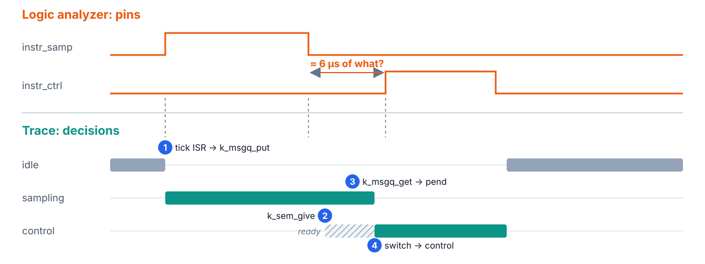
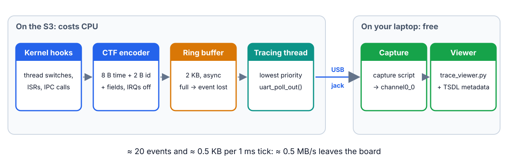
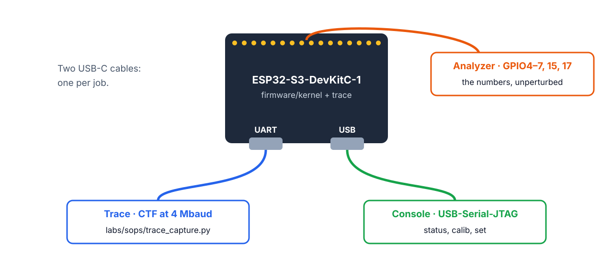
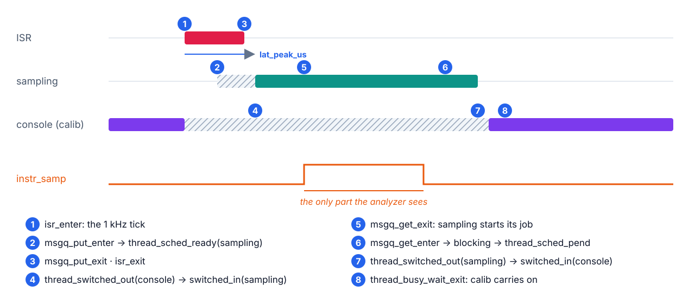

<!--
paginate: true
title: Tracing
style: |
  section {
    font-family: 'Inter', 'Segoe UI', 'DejaVu Sans', Arial, sans-serif;
    font-size: 26px;
    padding: 50px 64px;
    background: linear-gradient(180deg, #ffffff 0%, #ffffff 82%, #f0fdfa 100%);
    color: #0f172a;
  }
  h1 { color: #0d9488; }
  h2 {
    color: var(--accent, #0d9488);
    border-bottom: 6px solid var(--accent, #0d9488);
    padding-bottom: 6px;
    margin-bottom: 18px;
  }
  header {
    background: var(--accent, #0d9488);
    color: #fff;
    font-weight: 700;
    font-size: 18px;
    padding: 4px 14px;
    border-radius: 0 0 10px 10px;
    left: 64px;
    top: 0;
  }
  section::after { color: var(--accent, #0d9488); font-weight: 700; }
  img { display: block; margin: 0 auto; }
  strong { color: var(--accent, #0d9488); }
  table { font-size: 22px; margin: 0 auto; }
  th { background: var(--accent, #0d9488); color: #fff; }
  blockquote {
    border-left: 10px solid var(--accent, #0d9488);
    background: #f8fafc;
    padding: 14px 22px;
    border-radius: 0 12px 12px 0;
    color: #0f172a;
  }
  code { background: #f1f5f9; }
  pre { font-size: 19px; }
  section.lead {
    background: linear-gradient(135deg, #0d9488 0%, #2563eb 55%, #7c3aed 100%);
    color: #fff;
    justify-content: center;
  }
  section.lead h1 { color: #fff; font-size: 64px; }
  section.lead strong { color: #fde68a; }
  section.lead::after { color: #fff; }
  section.why    { --accent: #ea580c; }
  section.pipe   { --accent: #2563eb; }
  section.setup  { --accent: #16a34a; }
  section.read   { --accent: #0d9488; }
  section.cost   { --accent: #e11d48; }
  section.rtos   { --accent: #7c3aed; }
  section.use    { --accent: #d97706; }
  section.verdict {
    --accent: #db2777;
    background: linear-gradient(135deg, #fdf2f8 0%, #ede9fe 100%);
  }
  section.verdict blockquote { font-size: 30px; background: #fff; }
  section.agenda ol li { margin: 8px 0; padding-left: 6px; }
  section.agenda ol li::marker { font-weight: 800; }
  section.agenda ol li:nth-child(1)::marker, section.agenda ol li:nth-child(1) strong { color: #ea580c; }
  section.agenda ol li:nth-child(2)::marker, section.agenda ol li:nth-child(2) strong { color: #2563eb; }
  section.agenda ol li:nth-child(3)::marker, section.agenda ol li:nth-child(3) strong { color: #16a34a; }
  section.agenda ol li:nth-child(4)::marker, section.agenda ol li:nth-child(4) strong { color: #0d9488; }
  section.agenda ol li:nth-child(5)::marker, section.agenda ol li:nth-child(5) strong { color: #e11d48; }
  section.agenda ol li:nth-child(6)::marker, section.agenda ol li:nth-child(6) strong { color: #7c3aed; }
  section.agenda ol li:nth-child(7)::marker, section.agenda ol li:nth-child(7) strong { color: #d97706; }
-->

<!-- _class: lead -->
<!-- _paginate: false -->

# Tracing: seeing the scheduler

**Week 5 · demo** · the instrument labs 6 and 7 run on

The analyzer sees pins. The trace sees decisions.

<!--
0:00–1:00. Last week's Task C: a ≈ 4 µs gap between instr_samp falling and
instr_ctrl rising, and we *called* it a context switch. Today we watch it happen.
-->

---

<!-- _class: agenda -->

## Today

1. **Why**: what the analyzer can't see
2. **Pipeline**: from kernel hook to timeline
3. **Setup**: two jacks, three files
4. **Reading**: one preemption, event by event
5. **Cost**: the price of looking
6. **FreeRTOS**: same idea, other tools
7. **Use it**: from lab 6 on

The colored tag at the top of each slide tells you which part you're in.

<!--
1:00–1:30. About 20 minutes of slides, then the live demo on the node.
-->

---

<!-- _class: why -->
<!-- _header: 1 · Why -->

## Same moment, two instruments



<!--
1:30–3:30. Top: last week's capture. Ask: "What happened in those 4 µs?" They'll
say "a context switch". Bottom: sampling gives control's semaphore, control
becomes ready but can't preempt (priority 3 vs. 2), sampling blocks on tick_q,
and only then does the scheduler switch. On the analyzer, a switch, an ISR and a
slow instruction all look like the same flat line.
-->

---

<!-- _class: why -->
<!-- _header: 1 · Why -->

## What only the trace answers

| Question | Analyzer | Trace |
|---|---|---|
| How long did sampling run? | exact | close, but perturbed |
| What filled the 4 µs gap? | — | `k_sem_give`, pend, switch |
| Who ran during `calib`'s 400 ms? | only the pins you toggle | every thread, by name |
| Why did control start late? | — | who was ready, who had the CPU |
| Does measuring change the system? | no | **yes** |

Course rule from today: **numbers from the analyzer, story from the trace.**

<!--
3:30–5:00. The last row is the whole of part 5. Keep it on the board.
-->

---

<!-- _class: pipe -->
<!-- _header: 2 · Pipeline -->

## From kernel hook to timeline



Every kernel decision already calls a hook (`sys_port_trace_*`). `CONFIG_TRACING` fills them in.

<!--
5:00–7:00. Without CONFIG_TRACING the hooks are empty macros: zero cost. In async
mode (the default) a hook only copies its event into RAM; the tracing thread, at
the lowest priority, drains the buffer when nothing else wants the CPU. A full
buffer drops the event and counts it: the hook never blocks. SystemView is the
same idea with a debug probe reading the buffer out of RAM.
-->

---

<!-- _class: pipe -->
<!-- _header: 2 · Pipeline -->

## CTF: a binary log with a schema

```text
thread_switched_in: 34 bytes on the wire
  timestamp   8 B   ns since boot
  id          2 B   0x11
  thread_id   4 B   the thread's address
  name       20 B   "sampling_tid"
```

```c
event {
	name = thread_switched_in;
	id = 0x11;
	fields := struct { uint32_t thread_id; ctf_bounded_string_t name[20]; };
};
```

The stream carries **no lengths**: the reader takes each event's size from the **metadata**. One id missing there and every byte after it decodes as garbage.

<!--
7:00–9:00. CTF (Common Trace Format) is also what LTTng writes on Linux. The
metadata (TSDL) is $ZEPHYR_BASE/subsys/tracing/ctf/tsdl/metadata. Hold on to the
last sentence: it bites us on the "Build, capture, view" slide.
-->

---

<!-- _class: setup -->
<!-- _header: 3 · Setup -->

## Two jacks, two jobs



| Tempting route | Why not on our board |
|---|---|
| SystemView over RTT (J-Link) | Zephyr has no RTT on Espressif chips: Kconfig refuses it |
| CTF over `uart1` | the board routes its TX to GPIO17, our `instr_disp` |

<!--
9:00–10:30. The USB jack is the S3's built-in USB-Serial-JTAG: full-speed USB, no
adapter, no baud rate. Never trace over the console UART: the trace bytes would
mix with printk. Weeks 3–4 used only the UART jack; today both are plugged in.
-->

---

<!-- _class: setup -->
<!-- _header: 3 · Setup -->

## Turn it on: two files, no C

```ini
# firmware/kernel/trace.conf
CONFIG_TRACING=y
CONFIG_TRACING_CTF=y
CONFIG_TRACING_BACKEND_UART=y
CONFIG_TRACING_HANDLE_HOST_CMD=y   # wait for the capture script's "enable"
CONFIG_TRACING_SYSCALL=n
CONFIG_TRACING_TIMER=n
```

```c
/* firmware/kernel/usb_trace.overlay */
/ { chosen { zephyr,tracing-uart = &usb_serial; }; };
&usb_serial { status = "okay"; };
```

<!--
10:30–11:30. HANDLE_HOST_CMD keeps tracing off until the host sends "enable", so
the capture starts on an event boundary: a capture joined mid-stream starts
mid-event and nothing after it decodes. The two =n lines drop events we don't
read (part 5 shows how little that saves). CONFIG_THREAD_NAME is already on from
week 4: it is what puts names on the lanes.
-->

---

<!-- _class: setup -->
<!-- _header: 3 · Setup -->

## Build, capture, view

```bash
west build -p -b esp32s3_devkitc/esp32s3/procpu firmware/kernel -- \
  -DEXTRA_CONF_FILE=trace.conf -DEXTRA_DTC_OVERLAY_FILE=usb_trace.overlay
west flash && mkdir -p trace
python $ZEPHYR_BASE/scripts/tracing/trace_capture_uart.py \
  -d /dev/ttyACM0 -b 115200 -o trace/channel0_0     # Ctrl-C to stop
cp $ZEPHYR_BASE/subsys/tracing/ctf/tsdl/metadata trace/
grep -q sleep_ticks trace/metadata || cat firmware/kernel/ctf_sleep_events.tsdl >> trace/metadata
python $ZEPHYR_BASE/scripts/tracing/trace_viewer.py --metadata trace/metadata trace/channel0_0
```

> Zephyr main emits two `k_sleep` events that its own metadata doesn't describe (since Aug 2026). Without the `grep … || cat` line, the trace dies at the first `k_msleep`.

<!--
11:30–13:00. The USB jack ignores -b, but the script requires it. With the pot,
pass -DEXTRA_DTC_OVERLAY_FILE="pot_esp32s3.overlay;usb_trace.overlay".
trace_viewer.py exists on Zephyr main only (added June 2026); `babeltrace2 trace/`
gives a text dump on any version. The metadata gap is upstream commit a672a717cae.
-->

---

<!-- _class: read -->
<!-- _header: 4 · Reading -->

## One tick, one preemption



<!--
13:00–16:00. Narrate 1 → 8; the chain is copied from a real capture of this
firmware. Ask:
- "Where is lat_peak_us?" (1 → 5: tick to the thread's first instruction.)
- "Why does the console go to ready, not blocked?" (It was running; a preempted
  thread still wants the CPU.)
- "What changes on every 10th tick?" (Between 5 and 6 sampling gives control_sem;
  at 7 the switch goes to control, not to the console: last week's Task C gap.)
-->

---

<!-- _class: cost -->
<!-- _header: 5 · Cost -->

## The price of looking: bandwidth

| | Per 1 ms tick | Per second |
|---|---|---|
| The node's trace, filtered | ≈ 20 events, ≈ 0.5 KB | ≈ 0.5 MB/s |
| Ring buffer, 2 KB | full in ≈ 4 ms if not drained | |
| A 115200 UART, for scale | | ≈ 11.5 KB/s |

Six events per tick carry a 20-byte thread name (switches, ready, pend): ≈ 200 of the ≈ 500 bytes. Filtering `SYSCALL` and `TIMER` saved ≈ 13 %.

Trace **seconds, not minutes**, and expect **drops**: a full buffer loses whole events, so a lane with a missing switch is a gap, not a bug.

<!--
16:00–17:30. Counted from a native_sim capture of this firmware, median of 100
ticks: 26 events / 600 B unfiltered, 22 / 524 B filtered. The S3 will be close:
the 1 kHz tick sets the event mix, not the chip. Whether the USB jack keeps up is
part of the demo.
-->

---

<!-- _class: cost -->
<!-- _header: 5 · Cost -->

## The price of looking: time

- Each event is formatted with **interrupts locked** (`CTF_EVENT` → `irq_lock()`): a tick that fires meanwhile waits.
- ≈ 20 of them per tick, inside and around the very latency you're measuring.
- The tracing thread drains at the **lowest priority**: it eats idle time, so a CPU-load figure read off the trace includes the tracer.

> Measure the cost with the instrument that has none: sampling jitter on the **analyzer**, tracing on vs. off.

<!--
17:30–19:00. Misconception to anticipate: "trace timestamps are ground truth".
They are the truth as perturbed by tracing. Trace widths and GPIO widths differ by
µs both ways: GPIO includes gpio_pin_set_dt, the trace includes its own formatting.
-->

---

<!-- _class: rtos -->
<!-- _header: 6 · FreeRTOS -->

## What about FreeRTOS?

- Same idea: the kernel calls trace macros (`traceTASK_SWITCHED_IN()`, `traceQUEUE_SEND()`…) that stay empty until a recorder fills them.
- Recorders: **Percepio Tracealyzer** (commercial) or **SEGGER SystemView** (free for non-commercial use), usually through a debug probe.
- On the S3 under ESP-IDF, the app_trace library streams SystemView data over the same built-in USB-JTAG.
- What Zephyr adds: an **open format** (CTF) and free viewers.

<!--
19:00–20:00.
-->

---

<!-- _class: verdict -->
<!-- _header: Verdict -->

## Verdict

> **The analyzer is the witness; the trace is the suspect's own story.** Take numbers from the analyzer and explanations from the trace, and never quote a trace timestamp without a capture beside it.

<!--
20:00–20:30.
-->

---

<!-- _class: use -->
<!-- _header: Demo -->

## Demo: one `calib`, traced

1. Flash the traced build: console on the UART jack, capture on the USB jack.
2. Start the capture, type `calib` on the console, wait 2 s, Ctrl-C.
3. In the viewer, find the console lane busy-waiting; zoom on one tick and name events 1–8.
4. Find a 10th tick: `k_sem_give`, then the switch to control instead of the console.
5. Count `switched_in` against `switched_out`: equal, or did the link drop events?

<!--
20:30–28:00. Dry-run on your own board first:
- /dev/ttyACM0 appears when the USB jack is plugged in.
- trace/channel0_0 grows while the capture runs.
- The viewer's lanes run past the first second (if they stop early, the metadata
  patch is missing).
If the USB jack can't keep up, events drop: show it, that's the bandwidth slide live.
-->

---

<!-- _class: use -->
<!-- _header: 7 · Use it -->

## From lab 6 on

| Lab | Use the trace to… |
|---|---|
| 6 · Fig. 4.13 | see τ2 still *ready* when its deadline passes under RM |
| 6 · Task D | see `calib` spin (busy-wait events), then sleep once fixed |
| 6 · tracing cost | (analyzer, not trace) sampling jitter with tracing on vs. off |
| 7 · inversion | see who holds the lock while control waits |

Add `trace.conf` and `usb_trace.overlay` to any app; the third file is the metadata patch.

**Numbers from the analyzer, story from the trace.**

<!--
28:00–30:00. All three files live in firmware/kernel/.
-->
