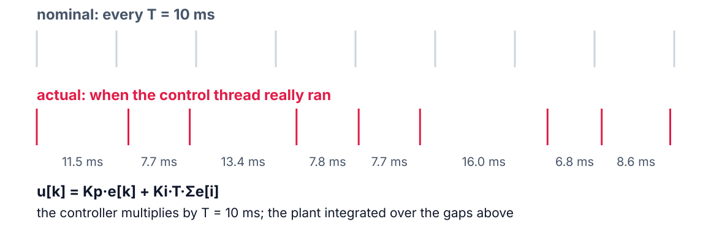

<!--
theme: course
paginate: true
title: Schedulability
math: mathjax
style: |
  section { --course: #0d9488; }
-->

<!-- _class: lead -->
<!-- _paginate: false -->

# Schedulability: does it fit?

**Week 6** · utilization, RM, EDF, and what jitter does to a control loop

Daniela wants two more sensors on the node. Answer with a number, not a feeling.

<!--
0:00–2:00. Hook: Samuel's memo. "Let's try and see" is how the console's calib
command got in. Today: U from measured C_i, and a test that says yes, no, or
"can't tell yet". Then we watch the book's most famous figure happen on the S3.
-->

---

<!-- _class: agenda -->

## Today

1. **Utilization**: the load, and what the RM tests promise
2. **EDF**: dynamic priorities, and Fig. 4.13 live
3. **Jitter**: why a loop degrades before it misses
4. **FreeRTOS**: fixed priorities only
5. **Lab**: what you'll measure

Goal: apply the RM and EDF tests, and say what a failed test does *not* mean.

<!--
2:00–3:00. Buttazzo §4.1–4.4 and §4.7 are this week's reading: statements and
examples, not the proofs.
-->

---

<!-- _class: s1 -->
<!-- _header: 1 · Utilization -->

## The load is one number

$$U = \sum_{i=1}^{n} \frac{C_i}{T_i}$$

- $C_i$: **measured** worst execution time (RET §1), not a guess
- $T_i$: the period from the requirement
- $U$ is the fraction of the CPU the periodic set needs

<!--
3:00–5:00. With measured C_i the number means something: it is the week-2/4
pulse widths divided by the periods. Work the node's set on the board: sampling
1 kHz, control 100 Hz, telemetry 1 Hz, display 20 Hz. Ask: what's missing from
this sum? (The console: it is not periodic. Week 11's servers handle that.)
-->

---

<!-- _class: s1 figure -->
<!-- _header: 1 · Utilization -->

## What each test promises

<!--
5:00–9:00. Liu & Layland: U ≤ n(2^(1/n) − 1) guarantees RM; 0.83 for two tasks,
→ ln 2 ≈ 0.69 as n grows. Hyperbolic test, ∏(U_i + 1) ≤ 2: same idea, less
pessimistic. Both are sufficient: passing proves schedulable, failing proves
nothing. The amber zone is "maybe": next week's RTA decides it task by task.
EDF's test is exact: U ≤ 1, full stop.
Misconception to anticipate: "U < 1 means it's schedulable". Only under EDF.
Under RM, 0.97 can fail, and they watch it fail this afternoon.
-->

---

<!-- _class: s1 question -->
<!-- _header: 1 · Utilization -->

## With Daniela's sensors the node runs at U = 0.85, under RM. What follows?

1. It will miss deadlines: 0.85 is above ln 2
2. Nothing yet: the test is only sufficient; run RTA
3. It is schedulable: U is below 1
4. Only EDF can run it now

<!--
9:00–11:00. Vote, one minute in pairs, vote again. Answer: 2. 1 reads a sufficient
test as necessary. 3 applies EDF's test to RM. 4 skips the analysis that could
still say yes: plenty of RM sets above the bound are schedulable (harmonic periods
reach U = 1).
-->

---

<!-- _class: s2 figure -->
<!-- _header: 2 · EDF -->

## Same two tasks, U = 0.97, two schedulers

<!--
11:00–16:00. Buttazzo Fig. 4.13, simulated by img/sc_figs.py: τ1 (C=2, T=5),
τ2 (C=4, T=7). Under RM, τ1 always wins; at t = 5 it preempts τ2 with one unit
left, and τ2's deadline at t = 7 passes. EDF compares absolute deadlines: at t = 5
τ2's deadline (7) is earlier than τ1's new one (10), so τ2 finishes first.
Point at the preemption counts: 5 under RM, 1 under EDF. The late RM job keeps
running here, as it will on the S3.
-->

---

<!-- _class: s2 -->
<!-- _header: 2 · EDF -->

## EDF: always run the earliest absolute deadline

- Priorities change at run time, job by job
- Exact test for $D_i = T_i$: schedulable **iff** $U \le 1$
- Optimal: if any algorithm meets every deadline, EDF does
- In Zephyr: `CONFIG_SCHED_DEADLINE=y`, then `k_thread_deadline_set()` each period

<!--
16:00–18:00. Optimality: Buttazzo §3.3.1, statement only. Zephyr's EDF orders
threads of the same static priority by deadline; that's how the lab runs it. The
deadline is relative to now, so it must be set again at every release.
-->

---

<!-- _class: s2 question -->
<!-- _header: 2 · EDF -->

## Which claim about RM and EDF holds?

1. EDF preempts more often than RM
2. RM is easier to build on a fixed-priority kernel
3. EDF cannot use the last few % of the CPU
4. RM meets every deadline while U < 1

<!--
18:00–20:00. Answer: 2, and it is most of why industry ships RM. 1: the figure
just showed the opposite (5 vs 1). 3: EDF reaches U = 1. 4 is the misconception
from segment 1. Buttazzo's "Rate Monotonic vs. EDF: Judgment Day" (2005) takes the
other common beliefs apart, overload behavior included.
-->

---

<!-- _class: s3 figure -->
<!-- _header: 3 · Jitter -->

## The controller assumes T; the plant gets T_k

<!--
20:00–24:00. A discrete PI loop is designed for a constant T. Jitter makes the
real interval vary, and the integral term multiplies by the wrong T at every step:
a disturbance the control course never modeled. Illustrative offsets, not a
capture; the lab measures the real thing.
-->

---

<!-- _class: s3 -->
<!-- _header: 3 · Jitter -->

## "Meets deadlines" and "controls well" are different bars

- A loop can meet every 10 ms deadline and still run late *inside* its period
- The error grows with jitter long before the first miss
- Daniela pays for the second bar: water where it should be

<!--
24:00–27:00. Task C of the lab: inject 0 / 2 / 5 ms of random delay before
actuating and measure the flow error. Ask for a prediction now: at which N does
the loop stop being useful? Write three guesses on the board; compare after the lab.
-->

---

<!-- _class: s4 -->
<!-- _header: 4 · FreeRTOS -->

## What about FreeRTOS?

- Fixed priorities only: no EDF in the kernel (most shipped RTOSes are the same)
- At U = 0.97 the professional move is to **redesign until RM passes**: fewer tasks, longer periods, harmonic periods
- That is why the book spends half a chapter on RM

<!--
27:00–29:00. Harmonic periods (each divides the next) let RM reach U = 1: a
redesign trick worth more than a kernel change.
-->

---

<!-- _class: takeaway -->

## The one thing to remember

> Below the bound, RM is guaranteed. Above it, RM is **unknown, not doomed**. Under EDF, U ≤ 1 is the whole answer.

<!--
29:00–30:00. Read it aloud. It is the first line of today's RET §4 entry.
-->

---

<!-- _class: s5 -->
<!-- _header: 5 · Lab -->

## Today in the lab

| Predict now | Then measure |
|---|---|
| Fig. 4.13 on the S3: who misses, when? | RM and EDF captures |
| Flow error at 0 / 2 / 5 ms of jitter | error vs. jitter |
| `calib`: 400 ms of CPU within 1 s? | CPU, before and after |
| E-stop: detection → valve low | worst of 5 trips |

Predictions are due before you power the board.

<!--
30:00–34:00. Task D needs the two sums; let them start them here.
For you: with the example Daniela tasks, the threads above the console hold
U ≈ 0.72, leaving ≈ 280 ms of each second for a 401 ms calib; after k_usleep it
needs ≈ 2 ms of CPU. The e-stop path is ≤ 1 + 10 + 1 ≈ 12 ms as shipped and
≈ 1 ms fixed. Next week's RTA puts exact numbers on both. Problem Set 1 goes out
today; the math from this talk is the math it drills.
-->

---

## References

- Buttazzo, *Hard Real-Time Computing Systems*, 4th ed.: §4.1–4.4, §4.7; §3.3.1 (EDF optimality, statement)
- C. L. Liu and J. W. Layland, "Scheduling algorithms for multiprogramming in a hard-real-time environment", *J. ACM* 20(1), 1973
- G. Buttazzo, "Rate Monotonic vs. EDF: Judgment Day", *Real-Time Systems* 29, 2005
- Optional: Lee & Seshia, *Introduction to Embedded Systems*, ch. 2 (free at leeseshia.org)
- Zephyr docs: *Scheduling*, earliest-deadline-first section

<!--
34:00–40:00. Questions; the references slide stays up while the lab starts.
-->
