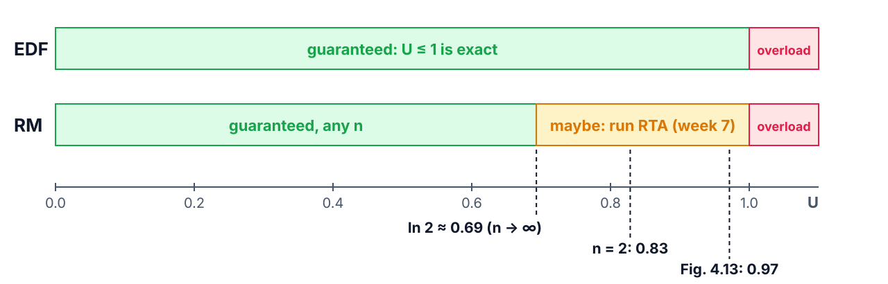
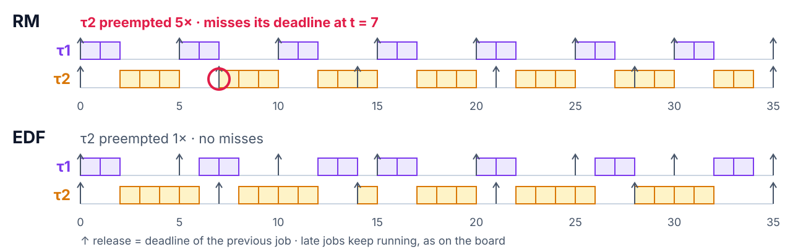
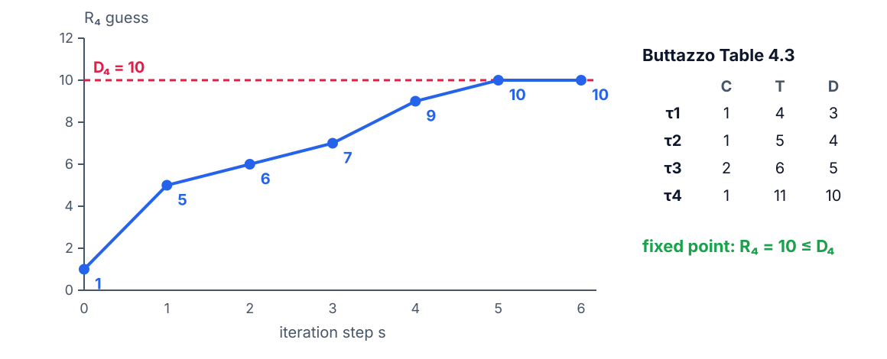
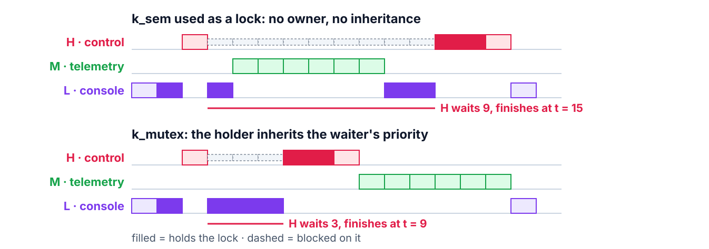

<!--
theme: course
paginate: true
title: Schedulability
math: mathjax
style: |
  section { --course: #0d9488; }
-->

<!-- _class: lead -->
<!-- _paginate: false -->

# Schedulability: does it fit, and how late?

**Week 6** · utilization, RM, EDF, response time, priority inversion

Daniela wants two more sensors on the node. Answer with a number, not a feeling.

<!--
0:00–1:30. Hook: Samuel's memo. "Let's try and see" is how the console's calib
command got in. Today: U from measured C_i and a test that says yes, no, or "can't
tell yet"; then each task's worst response; then the way a mutex breaks it. The
e-stop has a 5 ms deadline, not a percentage.
-->

---

<!-- _class: agenda -->

## Today

1. **Utilization**: the load, and what the RM tests promise
2. **EDF**: Fig. 4.13, live
3. **Response time**: each task's worst case, by iteration
4. **Inversion**: low holds, high waits, medium runs
5. **Lab**: what you'll measure

Goal: apply the RM and EDF tests, run RTA by hand, and bound the blocking a mutex adds.

<!--
1:30–2:30. Reading: Buttazzo §4.1–4.5.2, §4.7, §3.3.1 (EDF optimality,
statement); §7.1–7.3, §7.6.1, §7.7.1, Theorem 7.2 (statement). Statements and
examples, not the proofs.
-->

---

<!-- _class: s1 -->
<!-- _header: 1 · Utilization -->

## The load is one number

$$U = \sum_{i=1}^{n} \frac{C_i}{T_i}$$

- $C_i$: **measured** worst execution time (RET §1), not a guess
- $T_i$: the period from the requirement
- $U$ is the fraction of the CPU the periodic set needs

<!--
2:30–4:00. With measured C_i the number means something: it is the week-2/4
pulse widths divided by the periods. Work the node's set on the board: sampling
1 kHz, control 100 Hz, telemetry 1 Hz, display 20 Hz. Ask: what's missing from
this sum? (The console: it is not periodic. Week 10's servers handle that.)
-->

---

<!-- _class: s1 figure -->
<!-- _header: 1 · Utilization -->

## What each test promises

<!--
4:00–7:00. Liu & Layland: U ≤ n(2^(1/n) − 1) guarantees RM; 0.83 for two tasks,
→ ln 2 ≈ 0.69 as n grows. Hyperbolic test, ∏(U_i + 1) ≤ 2: same idea, less
pessimistic. Both are sufficient: passing proves schedulable, failing proves
nothing. The amber zone is "maybe": segment 3's RTA decides it task by task.
EDF's test is exact: U ≤ 1, full stop.
Misconception to anticipate: "U < 1 means it's schedulable". Only under EDF.
Under RM, 0.97 can fail, and they watch it fail this afternoon.
-->

---

<!-- _class: s1 question -->
<!-- _header: 1 · Utilization -->

## With Daniela's sensors the node runs at U = 0.85, under RM. What follows?

1. It will miss deadlines: 0.85 is above ln 2
2. Nothing yet: the test is only sufficient; run RTA
3. It is schedulable: U is below 1
4. Only EDF can run it now

<!--
7:00–9:00. Vote, one minute in pairs, vote again. Answer: 2. 1 reads a sufficient
test as necessary. 3 applies EDF's test to RM. 4 skips the analysis that could
still say yes: plenty of RM sets above the bound are schedulable (harmonic periods
reach U = 1).
-->

---

<!-- _class: s2 figure -->
<!-- _header: 2 · EDF -->

## Same two tasks, U = 0.97, two schedulers

<!--
9:00–13:00. Buttazzo Fig. 4.13, simulated by img/sc_figs.py: τ1 (C=2, T=5),
τ2 (C=4, T=7). Under RM, τ1 always wins; at t = 5 it preempts τ2 with one unit
left, and τ2's deadline at t = 7 passes. EDF compares absolute deadlines: at t = 5
τ2's deadline (7) is earlier than τ1's new one (10), so τ2 finishes first.
Point at the preemption counts: 5 under RM, 1 under EDF. The late RM job keeps
running here, as it will on the S3.
-->

---

<!-- _class: s2 -->
<!-- _header: 2 · EDF -->

## EDF: always run the earliest absolute deadline

- Priorities change at run time, job by job
- Exact test for $D_i = T_i$: schedulable **iff** $U \le 1$
- Optimal: if any algorithm meets every deadline, EDF does
- In Zephyr: `CONFIG_SCHED_DEADLINE=y`, then `k_thread_deadline_set()` each period

<!--
13:00–15:00. Optimality: Buttazzo §3.3.1, statement only. Zephyr's EDF orders
threads of the same static priority by deadline; that's how the lab runs it. The
deadline is relative to now, so it must be set again at every release. Why
industry still ships RM: it is what a fixed-priority kernel does for free.
-->

---

<!-- _class: s3 -->
<!-- _header: 3 · Response time -->

## A task's worst response: itself, plus everyone above it

$$R_i = C_i + \sum_{h < i} \left\lceil \frac{R_i}{T_h} \right\rceil C_h$$

- $R_i$ is on both sides: start at $C_i$, iterate until it stops moving
- Stop early if it passes $D_i$: the task isn't schedulable
- Fifteen lines of Python, fed with **measured** $C_i$: a tool, not a theorem

<!--
15:00–17:00. Buttazzo Fig. 4.17 is the algorithm. The ceiling counts how many
times each higher-priority task can release inside the window R_i. Writing the
script is homework; the workshop re-runs it live.
-->

---

<!-- _class: s3 figure -->
<!-- _header: 3 · Response time -->

## The book's example, step by step

<!--
17:00–20:00. Buttazzo Table 4.3, computed by img/rta_figs.py. Work steps 1 and 2 on
the board: R = 1 + ⌈1/4⌉·1 + ⌈1/5⌉·1 + ⌈1/6⌉·2 = 5; then with R = 5 the window
holds two releases of τ1. It settles at 10, exactly D4.
-->

---

<!-- _class: s3 question -->
<!-- _header: 3 · Response time -->

## Control's RTA says R = 2.1 ms. A 30 s capture shows 1.8 ms at most. Which is wrong?

1. The RTA: it's pessimistic, ignore it
2. The capture: it missed events
3. Neither: the critical instant is rare, the capture didn't hit it
4. Both: average them

<!--
20:00–22:00. Answer: 3. The RTA assumes every higher-priority task releases at the
same instant; 30 s rarely contains that. If the capture ever exceeds the RTA, the
C_i are wrong. Numbers are illustrative.
-->

---

<!-- _class: s4 -->
<!-- _header: 4 · Inversion -->

## Mars, July 1997: Pathfinder keeps rebooting

- A high-priority bus-management task and a low-priority weather task shared a mutex
- A medium-priority communications task preempted the low one while it held the lock
- The high task waited on the **medium** one; the watchdog saw it late and reset the lander
- JPL replayed the trace on Earth; the fix was one mutex attribute: priority inheritance

<!--
22:00–24:00. Pathfinder ran VxWorks; inheritance was available and off. The story
is the course's house rule in action: the trace found it.
-->

---

<!-- _class: s4 figure -->
<!-- _header: 4 · Inversion -->

## Three threads, one lock, two policies

<!--
24:00–27:00. Simulated by img/rta_figs.py. Top: L takes the lock, H asks for it and
blocks, M (no lock at all) preempts L: H now waits for M, 9 units. Bottom: while L
holds the lock it runs at H's priority, so M can't intervene: H waits only for L's
critical section, 3 units. Ask which of our threads plays each role: control (H),
telemetry (M), console (L). That is this afternoon's Task B.
-->

---

<!-- _class: s4 question -->
<!-- _header: 4 · Inversion -->

## Control and the console share a `k_sem` of 1 as a lock. What protects control?

1. Its higher priority
2. Nothing: a semaphore has no owner to inherit through
3. The semaphore's FIFO wait queue
4. The short critical section

<!--
27:00–29:00. Answer: 2. Misconception to anticipate: "a semaphore is a mutex". A
binary semaphore has no owner, so the kernel can't raise anyone's priority: it
allows exactly the top timeline. 4 bounds the critical section, not the time M
runs. For mutual exclusion across priorities: a PI mutex, always.
-->

---

<!-- _class: s4 -->
<!-- _header: 4 · Inversion -->

## The wait doesn't vanish: it becomes bounded

$$R_i = C_i + B_i + \sum_{h < i} \left\lceil \frac{R_i}{T_h} \right\rceil C_h$$

- $B_i$: the longest critical sections that can block task $i$ (Theorem 7.2)
- Zephyr's `k_mutex` inherits priority; `k_sem` doesn't
- PCP (ceilings): no deadlock, at most one blocking; worth knowing it exists

<!--
29:00–31:00. Under PIP a task can be blocked at most once per lower-priority task
that shares a resource with it, by at most one critical section each: that is the
min(l_i, s_i) in Theorem 7.2. The homework script takes B from Task B's GPIO pulse
and must bound the PI-mutex capture.
-->

---

<!-- _class: s4 -->
<!-- _header: What about FreeRTOS? -->

## What about FreeRTOS?

- Fixed priorities only: no EDF. At U = 0.97, **redesign until RM passes** (harmonic periods reach U = 1)
- `xSemaphoreCreateMutex` inherits priority; binary semaphores allow the inversion, like `k_sem`
- Pathfinder ran VxWorks: the lesson doesn't depend on the kernel

<!--
31:00–32:00. Most shipped RTOSes are fixed-priority, which is why the book spends
half a chapter on RM.
-->

---

<!-- _class: takeaway -->

## The one thing to remember

> Below the bound, RM is guaranteed; above it, RTA decides. Across priorities, lock with a mutex that inherits, and add $B_i$ to the sum.

<!--
32:00–33:00. Read it aloud. It is the first line of today's RET §4 entry.
-->

---

<!-- _class: s5 -->
<!-- _header: 5 · Lab -->

## Today in the lab

| Predict now | Then measure |
|---|---|
| Fig. 4.13 on the S3: who misses, when? | RM and EDF captures |
| Control's R: no lock, `k_sem`, `k_mutex` | three captures |
| `calib`: 400 ms of CPU within 1 s? | CPU, before and after |
| E-stop: detection → valve low | worst of 5 trips |

Predictions are due before you power the board.

<!--
33:00–37:00. Task C needs the two sums; let them start them here.
For you: with the example Daniela tasks, the threads above the console hold
U ≈ 0.72, leaving ≈ 280 ms of each second for a 401 ms calib; after k_usleep it
needs ≈ 2 ms of CPU. The e-stop path is ≤ 1 + 10 + 1 ≈ 12 ms as shipped and
≈ 1 ms fixed. The Problem Set goes out today, due at next week's workshop, with
Daniela's U test and the RTA script.
-->

---

## References

- Buttazzo, *Hard Real-Time Computing Systems*, 4th ed.: §4.1–4.5.2 (RTA, Fig. 4.17), §4.7; §3.3.1; §7.1–7.3, §7.6.1 (PIP), §7.7.1 (PCP), Theorem 7.2
- C. L. Liu and J. W. Layland, "Scheduling algorithms for multiprogramming in a hard-real-time environment", *J. ACM* 20(1), 1973
- G. Buttazzo, "Rate Monotonic vs. EDF: Judgment Day", *Real-Time Systems* 29, 2005
- G. Reeves, "What really happened on Mars?", JPL, 1997
- Optional: Lee & Seshia, *Introduction to Embedded Systems*, ch. 2 (free at leeseshia.org)
- Zephyr docs: *Scheduling* (EDF), *Mutexes* (priority inheritance)

<!--
37:00–40:00. Questions; the references slide stays up while the lab starts.
-->
