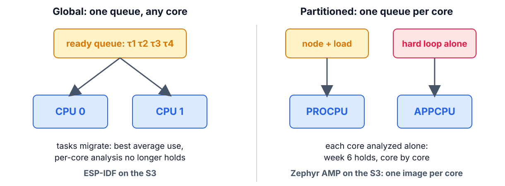
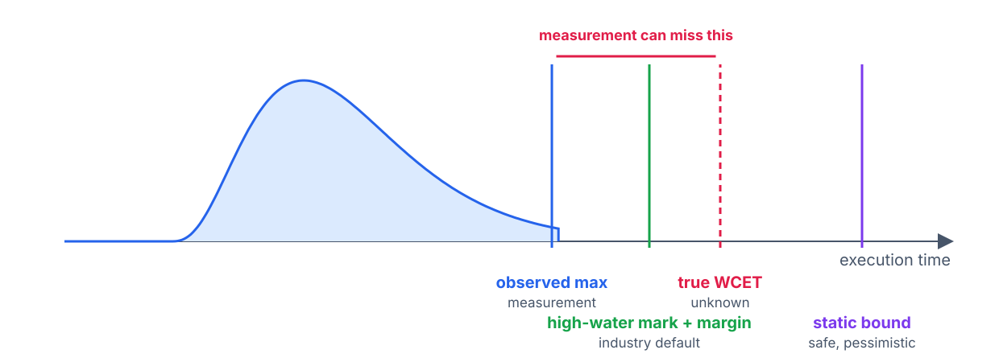

<!--
theme: course
paginate: true
title: FreeRTOS, multicore, WCET
style: |
  section { --course: #0d9488; }
-->

<!-- _class: lead -->
<!-- _paginate: false -->

# FreeRTOS, two cores, and the worst case

**Week 8** · the industry's kernel, honestly; partitioning; where C_i comes from

A customer demands FreeRTOS. What do you actually gain and lose?

<!--
0:00–2:00. This is FreeRTOS's dedicated session: the weekly aside becomes the
headline. Then the S3's second core, and an honest look at the C_i column we've
been filling since week 2.
-->

---

<!-- _class: agenda -->

## Today

1. **FreeRTOS**: the map, the strengths, the verdict
2. **Multicore**: global or partitioned
3. **WCET**: what measurement can and can't promise
4. **Guided build**: the project's node, split across the cores

Goal: argue when each kernel is right, and which multicore model protects the tail.

<!--
2:00–3:00. Reading: Buttazzo §13.1–13.2, §13.5; §2.4 as the multiprocessor hook.
FreeRTOS isn't in the book: the official docs are the reference.
-->

---

<!-- _class: s1 -->
<!-- _header: 1 · FreeRTOS -->

## Everything you learned transfers

| Zephyr | FreeRTOS |
|---|---|
| `K_THREAD_DEFINE` | `xTaskCreate` |
| `k_msgq` | `xQueue` |
| `k_sem` / `k_mutex` | semaphore / mutex with inheritance |
| `k_work` | timer-daemon task, or a worker of your own |

<!--
3:00–6:00. Build the right column with the class. One habit flip from week 3:
FreeRTOS priorities count up.
-->

---

<!-- _class: s1 -->
<!-- _header: 1 · FreeRTOS -->

## Where each one wins

| FreeRTOS | Zephyr |
|---|---|
| tiny, and in every vendor SDK | one toolchain across chips (devicetree) |
| SMP on this S3, through ESP-IDF | no SMP on the S3: AMP only |
| — | EDF; drivers, shell and logging built in |

<!--
6:00–10:00. Honest weaknesses of FreeRTOS: no devicetree (portability means an
SDK change), no EDF, fewer built-in services. Honest weakness of Zephyr here: no
SMP on the S3 (it has SMP on the original ESP32, not this chip).
-->

---

<!-- _class: s1 question -->
<!-- _header: 1 · FreeRTOS -->

## Product A: this S3, radio on, both cores squeezed. Product B: a family on three vendors' chips. Which kernel for which?

1. FreeRTOS for both: it's the industry standard
2. A: ESP-IDF/FreeRTOS · B: Zephyr
3. A: Zephyr · B: FreeRTOS
4. Zephyr for both: it has EDF

<!--
10:00–12:00. Answer: 2. A wants the vendor's mature SMP and radio stack on one
chip; B wants one toolchain and devicetree across silicon. 1 and 4 pick a kernel
before reading the product.
-->

---

<!-- _class: s2 figure -->
<!-- _header: 2 · Multicore -->

## Global or partitioned

<!--
12:00–17:00. Global: one scheduler migrates tasks across cores; best average
utilization, but migration jitter and shared-cache interference, and the
uniprocessor analysis no longer applies directly. Partitioned: tasks pinned per
core, each core analyzed alone with week 6. On the S3, Zephyr gives us
partitioned by construction: sysbuild, one image per core, the hard loop alone on
APPCPU with no console there (GPIO is the instrument, as always).
-->

---

<!-- _class: s2 question -->
<!-- _header: 2 · Multicore -->

## The hard loop moves alone to the second core. What changes most?

1. Its average jitter halves
2. It runs twice as fast
3. Its rare worst-case spikes disappear
4. Nothing: one core was enough

<!--
17:00–19:00. Answer: 3, with a catch the lab will show. Misconceptions: "two
cores, twice the capacity" (1, 2). Averages barely move; what a dedicated core buys
is the tail. Measured on the S3 (2026-10-21), max jitter over 60 s: one core
2.25 µs; APPCPU alone 0.25 µs. But with a load streaming from flash on PROCPU the
APPCPU loop reached 12–21 µs, worse than sharing one core (10.5 µs): the cores
still share the flash cache. With the hard path in IRAM it is 0.25 µs again.
-->

---

<!-- _class: s3 figure -->
<!-- _header: 3 · WCET -->

## What each method bounds

<!--
19:00–24:00. After Wilhelm et al. (2008), Fig. 1. Static analysis gives a safe
bound but needs a model of the cache and pipeline, and explodes on the S3's flash
cache. Pure measurement is cheap and can miss the worst path. The industry default
is the high-water mark under stress plus an engineering margin: that is the RET's
C_i column, and today's stress thread is what makes the high-water mark honest.
-->

---

<!-- _class: s3 question -->
<!-- _header: 3 · WCET -->

## Why is static WCET easier on the L476 with its cache off than on the S3?

1. The L476 is slower
2. Without a cache, every fetch costs the same: no history to model
3. The S3 has two cores
4. Static analysis only supports ARM

<!--
24:00–26:00. Answer: 2: week 2's cache-off measurement, resurfacing. The S3
fetches from external flash through a cache, so an instruction's cost depends on
what ran before it.
-->

---

<!-- _class: takeaway -->

## The one thing to remember

> A dedicated core doesn't make the loop faster; it removes the spikes that came from sharing the CPU. Whatever the cores still share, like the S3's flash cache, keeps its spikes. Judge it by the max.

<!--
26:00–27:00.
-->

---

<!-- _class: s4 -->
<!-- _header: 4 · Guided build -->

## Today: we build the project's node together

1. Both cores alive: the `ipm_esp32` sample, one flash
2. The split: the hard path on APPCPU, everything else on PROCPU, IPM between them
3. The tail table, with a synthetic load, and the inter-core hop
4. The hard path in internal RAM: the last row

Predict the maxima now. Each step's check passes before anyone moves on.

<!--
27:00–32:00. Run each step on the projector first (SOP-08), then the pairs. Two
images from one sysbuild; ADR-003 must cite the cost: two images, no console on
APPCPU, and the hop an e-stop now takes to reach PROCPU. That hop joins the e2e
budget at the kickoff; checkpoint 1 runs this node with CAN on PROCPU.
-->

---

## References

- Buttazzo, §13.1–13.2, §13.5; §2.4
- FreeRTOS docs: *Tasks*, *Queues*, *Mutexes*, SMP
- R. Wilhelm et al., "The worst-case execution-time problem: overview of methods and survey of tools", *ACM TECS* 7(3), 2008
- Zephyr docs: *Sysbuild*; the `ipm_esp32` sample

<!--
32:00–40:00. Questions, then the lab.
-->
