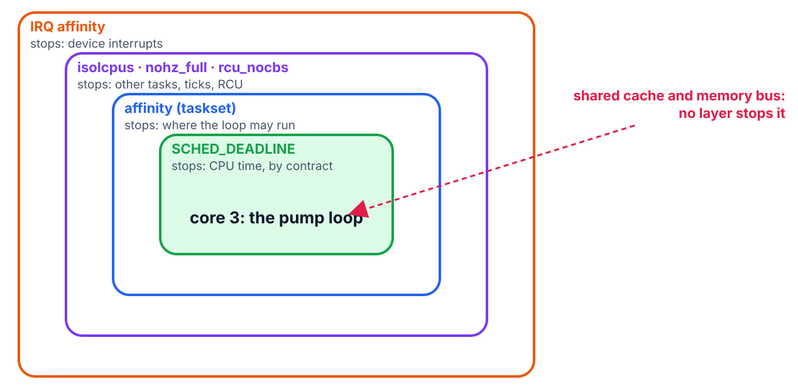

<!--
theme: course
paginate: true
title: SCHED_DEADLINE and isolation
math: mathjax
style: |
  section { --course: #0d9488; }
-->

<!-- _class: lead -->
<!-- _paginate: false -->

# Contracts and isolation

**Week 10** · CBS → `SCHED_DEADLINE`; affinity, isolated cores, IRQ steering

One process at FIFO 95, a typo or an installer default, and the pump loop gets no CPU. Forever.

<!--
0:00–1:30. On the node we reviewed every task. The Hub runs a GUI toolkit and a
network stack we didn't write, and it will render and take telemetry in bursts.
Today the loop gets a contract, then armor. The lab's rig is checkpoint 2's rig.
-->

---

<!-- _class: agenda -->

## Today

1. **Why priorities stop being enough**
2. **Reservation**: the Constant Bandwidth Server
3. **`SCHED_DEADLINE`**: the CBS, in the Linux kernel
4. **Isolation**: the doors a contract doesn't close
5. **Lab**: the Hub's dress rehearsal

Goal: turn a measured loop into a runtime/period contract, and name what each isolation layer removes.

<!--
1:30–2:30. Reading: Buttazzo §6.9.1–6.9.4 (CBS), §9.3, all of ch. 12, §13.1.1.
The rest of chs. 5–6 gets one intuition sentence: other servers exist.
-->

---

<!-- _class: s1 -->
<!-- _header: 1 · Priorities -->

## A priority is a relative claim

- It guarantees you beat whoever is below you, not **how much** CPU you get
- On the node that was enough: all the code was ours, and reviewed
- On the Hub, the GUI and the routing stack are someone else's code

<!--
2:30–4:30. Question for the room: whose code review protects you here? Nobody's:
that's the point.
-->

---

<!-- _class: s2 figure -->
<!-- _header: 2 · Reservation -->

## The same hog, two policies

<!--
4:30–8:30. Top: the hog at FIFO 95 starts at 3 ms and never stops; the loop at 90
never runs again. No bug, just arithmetic. Bottom: the loop holds a reservation of
2 ms every 10 ms. Deadline tasks run before any FIFO task, so the loop gets its
1.1 ms each period and the hog gets everything else. The purple line is the loop's
budget: spent while it runs, recharged each period.
-->

---

<!-- _class: s2 -->
<!-- _header: 2 · Reservation -->

## The Constant Bandwidth Server, in three rules

1. A job arrives at an idle server: keep the deadline if the leftover budget fits; else deadline = now + $T_s$, budget = $Q_s$
2. Running spends budget
3. Budget at zero: recharge $Q_s$, deadline += $T_s$

EDF picks among servers. Isolation: $U_s = Q_s/T_s$, whatever else runs.

<!--
8:30–12:30. Buttazzo Fig. 6.15 and Theorem 6.8. The second result: inside the
reservation, R_i ≈ C_i / U_s. Under SCHED_DEADLINE, rule 3 throttles the task until
its next period: a hard reservation.
-->

---

<!-- _class: s2 question -->
<!-- _header: 2 · Reservation -->

## The loop asks for 1 ms every 10 ms but needs 1.1 ms. Who suffers?

1. The hog: DEADLINE always wins
2. The loop: it's throttled until the next period
3. Nobody: the kernel lends it the extra 0.1 ms
4. The GUI: it loses its slice

<!--
12:30–14:30. Answer: 2. Misconception to anticipate: "DEADLINE is just a very high
priority". It is a contract, and it binds you too. Undersizing Q_s hurts you, not
the neighbors: hence the lab's margin question.
-->

---

<!-- _class: s3 -->
<!-- _header: 3 · SCHED_DEADLINE -->

## Signing the contract

- `sched_setattr()` with runtime ≤ deadline ≤ period, in ns
- **Admission control**: the kernel refuses a contract that would oversubscribe the CPUs (week 6's test, at syscall time)
- `chrt -d --sched-runtime … --sched-period … 0 ./pump_loop` from the shell

<!--
14:30–17:30. Ask: the loop measured C ≈ 1.1 ms per 10 ms. What runtime do you
request, and what's the argument for the cushion? (Measured high-water mark under
load, plus margin for what the measurement may have missed: week 8.) The default
limit leaves 5 % of each CPU to non-RT work (sched_rt_runtime_us). One rule bites
in the lab: a DEADLINE task's affinity must cover its whole scheduling domain, so
pin first (to the isolated core), then set the policy.
-->

---

<!-- _class: s4 -->
<!-- _header: 4 · Isolation -->

## CPU time is secured. Interference has other doors

- **Device interrupts** land on your core and run before you
- **Kernel housekeeping**: the tick, RCU callbacks, run everywhere by default
- **The memory system**: a neighbor thrashing the shared cache slows your instructions without taking a single time slice

<!--
17:30–20:30. The last one is week 3's silicon lesson, now with four cores, and
week 8's: a dedicated core still shares the cache.
-->

---

<!-- _class: s4 figure -->
<!-- _header: 4 · Isolation -->

## One layer per door

<!--
20:30–25:00. SCHED_DEADLINE: CPU time. Affinity (taskset, sched_setaffinity):
placement. isolcpus nohz_full rcu_nocbs on the kernel command line: evict the
scheduler's other clients and the housekeeping from core 3. /proc/irq/*/smp_affinity:
send device interrupts elsewhere. Rows 4–6 of the lab add one layer per row; each
row should eat tail. The shared cache has no Linux knob on the Pi: it is the
residue the measurement will show. A dedicated core (week 8) is this recipe in
silicon; Linux needs it spelled out because the box is shared.
-->

---

<!-- _class: s4 question -->
<!-- _header: 4 · Isolation -->

## `isolcpus=3` is set and the loop is pinned to core 3. Still jittery. Why?

1. isolcpus doesn't work on ARM
2. Device interrupts still land on core 3
3. The loop needs a higher FIFO priority
4. Core 3 is slower than the others

<!--
25:00–27:00. Answer: 2. Misconception to anticipate: "isolcpus alone is enough".
Unpinned IRQs still land there, and without the contract a rogue FIFO task pinned
to the same core still wins: rows 2 and 6 of the lab. No single layer survives
alone.
-->

---

<!-- _class: s4 -->
<!-- _header: 4 · Isolation -->

## A configuration in someone's shell history dies at deployment

- ADR-004 is the recipe as literal commands and command-line parameters
- Every line cites the table row that justifies it
- Edwin's bar: another group replays it in 10 minutes

<!--
27:00–28:30. ADR-004 is homework, due at the kickoff: ADR-P3 adapts it.
-->

---

<!-- _class: s4 -->
<!-- _header: What about FreeRTOS? -->

## What about FreeRTOS?

- No reservations in FreeRTOS or Zephyr: priorities only. On an MCU, review replaces contracts
- FreeRTOS SMP has affinity (`vTaskCoreAffinitySet`); isolation is "put nothing else on that core"
- Both work because every task is yours. The Hub runs software you don't own

<!--
28:30–29:30. Same principle as week 8 (partitioning cuts tails), a more hostile
ecosystem: that is why the Hub is Linux, and why these mechanisms live there.
-->

---

<!-- _class: takeaway -->

## The one thing to remember

> A priority says who goes first. A reservation says how much you get, no matter who else runs. Isolation closes the other doors, one layer at a time, and the recipe is the deliverable.

<!--
29:30–30:30.
-->

---

<!-- _class: s5 -->
<!-- _header: 5 · Lab -->

## Today in the lab

| Predict now | Then measure |
|---|---|
| Misses, FIFO 90 + a FIFO 95 hog on core 3 | the freeze, captured |
| Misses, DEADLINE 2/10 + the same hog | misses = 0? |
| Max jitter, DEADLINE, shared cores, full interference | 5 min, histogram |
| + isolated core 3, then + IRQs moved | the same rig |

<!--
30:30–35:00. Buttazzo ch. 12's ptask pattern nearly verbatim. Core 3 is isolated
before the lab (one reboot), so every row runs without touching the cmdline.
Expected shape: row 2 starves, row 3 holds; the max collapses as layers stack in
rows 4–6, and row 6's number is the one the project inherits. Content closes
today: everything after this is the Hub.
-->

---

## References

- Buttazzo, §6.9.1–6.9.4 (CBS, Fig. 6.15, Theorem 6.8), §9.3; ch. 12 (the ptask pattern); §13.1.1 (RT-POSIX)
- Linux kernel docs: *Deadline Task Scheduling*; *kernel-parameters* (`isolcpus`, `nohz_full`, `rcu_nocbs`); *IRQ affinity*
- `man 7 sched`, `man 2 sched_setattr`, `man 1 chrt`
- SOP-09 §5: the commands

<!--
35:00–40:00. Questions, then the rig.
-->
