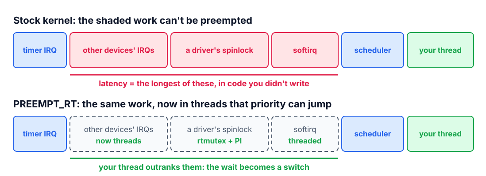

<!--
theme: course
paginate: true
title: PREEMPT_RT
math: mathjax
style: |
  section { --course: #0d9488; }
-->

<!-- _class: lead -->
<!-- _paginate: false -->

# PREEMPT_RT: Linux enters the loop

**Week 10** · why stock Linux is late, and what the RT kernel changes

The Hub runs Linux. Its tardiness is a reputation; today it becomes a histogram.

<!--
0:00–2:00. The Hub does GUI, routing and cloud: you don't do that on an MCU. It also
controls the pump station. Groups merge today; the Hub Kit debuts.
-->

---

<!-- _class: agenda -->

## Today

1. **Why stock Linux is late**: work that priority can't jump
2. **What PREEMPT_RT changes**: almost everything preemptible
3. **cyclictest**: the instrument and its protocol
4. **The scale change**: µs on the MCU, tens of µs here
5. **Lab**: the four-condition table

Goal: say why stock Linux has unbounded latency, and read a histogram by its max.

<!--
2:00–3:00. Reading: Buttazzo §13.3.4–13.3.5.
-->

---

<!-- _class: s1 figure -->
<!-- _header: 1 · Why stock Linux is late -->

## Between the timer and your thread

<!--
3:00–9:00. Top row: between a timer firing and your thread running sit things
priority can't jump: other devices' interrupt handlers, a driver holding a
spinlock, softirq processing. On the MCU we owned every line of code; here the
longest critical section belongs to a driver we've never read. Week 2's latency
anatomy, at a larger scale. Segment lengths are schematic.
-->

---

<!-- _class: s1 question -->
<!-- _header: 1 · Why stock Linux is late -->

## "A driver holds a spinlock while your thread waits." Which week-7 idea is that?

1. Interference from higher-priority tasks
2. Blocking: $B_i$, by code you don't control
3. Priority inversion with inheritance
4. Jitter in the release time

<!--
9:00–11:00. Answer: 2. It is a critical section of a lower-priority activity that
delays you; the difference from week 7 is that you can't bound it by reading the
code, because it isn't yours.
-->

---

<!-- _class: s2 -->
<!-- _header: 2 · What PREEMPT_RT changes -->

## Make almost everything preemptible

- Interrupt handlers become **kernel threads**: an RT task can outrank a network card
- Spinlocks become **rtmutexes** that sleep and **inherit priority**: week 7's PIP, inside the kernel
- Softirqs run in threads too
- Merged into mainline Linux in 6.12 (2024); the Pi still needs a kernel built with it

<!--
11:00–16:00. Back to the figure's second row: the same work, now schedulable.
What remains non-preemptible is small: the hard IRQ entry, raw spinlocks in core
code.
Misconception to anticipate: "the RT kernel makes Linux faster". Throughput
usually gets worse: more preemption, more switches. It trades average performance
for a bounded tail. If the mean improves and the max doesn't, you got nothing.
-->

---

<!-- _class: s3 -->
<!-- _header: 3 · cyclictest -->

## The instrument, and how not to fool yourself

`cyclictest -m -Sp90 -i 1000 -h 400 -D 5m`

- A thread sleeps 1 ms, wakes, logs (actual − expected): the histogram is the kernel's promise, measured
- RT priority (`-Sp90`), **≥ 5 minutes**, and **under load**: an idle histogram is marketing
- The **max** is the verdict; p99 is context
- Lock the CPU governor to `performance`: frequency scaling wrecks the tail

<!--
16:00–21:00. -m locks memory (no page faults), -h 400 keeps a histogram to 400 µs.
The load: stress-ng on CPU and I/O plus a ping flood from a laptop. The DFS row of
the lab shows what the powersave governor does.
-->

---

<!-- _class: s3 question -->
<!-- _header: 3 · cyclictest -->

## Five minutes, idle: max 40 µs. What may you promise for the pump loop?

1. 40 µs, with margin
2. Nothing yet: no load, too short
3. 40 µs × 2, the usual safety factor
4. The p99, since the max is an outlier

<!--
21:00–23:00. Answer: 2. The tail comes from contention; an idle box has none. 4 is
the soft-real-time habit this course unlearns: the max is not an outlier, it is the
answer.
-->

---

<!-- _class: s4 -->
<!-- _header: 4 · The scale change -->

## Same theory, two orders of magnitude

- MCU (weeks 2–9): the worst case comes from a small kernel you can read, **µs**
- RT Linux: from a giant one, **tens to hundreds of µs**, even with PREEMPT_RT
- That gap is the number the Hub's partitioning ADR is built on

<!--
23:00–26:00. What about FreeRTOS? Change of scale, same question: on the MCU the
worst case came from a small kernel, FreeRTOS or Zephyr alike. MCUs rarely scale
their clock dynamically; Linux SBCs do, which is today's DFS row.
-->

---

<!-- _class: takeaway -->

## The one thing to remember

> PREEMPT_RT doesn't make Linux fast; it makes its worst case boundable. Measure that worst case under load, for minutes, and read the max.

<!--
26:00–27:00.
-->

---

<!-- _class: s5 -->
<!-- _header: 5 · Lab -->

## Today in the lab

| Predict now | Then measure |
|---|---|
| Max, stock kernel, idle and loaded | `cyclictest`, 5 min each |
| Max, PREEMPT_RT, idle and loaded | the same protocol |
| Max, RT, loaded, `powersave` governor | the DFS penalty |

<!--
27:00–32:00. Predictions to write down: stock-loaded's max is the scary one;
RT-loaded lands well under the pump loop's 10 ms, but nowhere near week 9's µs.
SOP-10 has the image, the commands and the plot script.
-->

---

## References

- Buttazzo, §13.3.4–13.3.5
- Linux kernel docs: *Real-time preemption* (PREEMPT_RT); `rt-tests` (cyclictest)
- SOP-10: the image, the runs, the histogram script

<!--
32:00–40:00. Questions, then SBC bring-up.
-->
