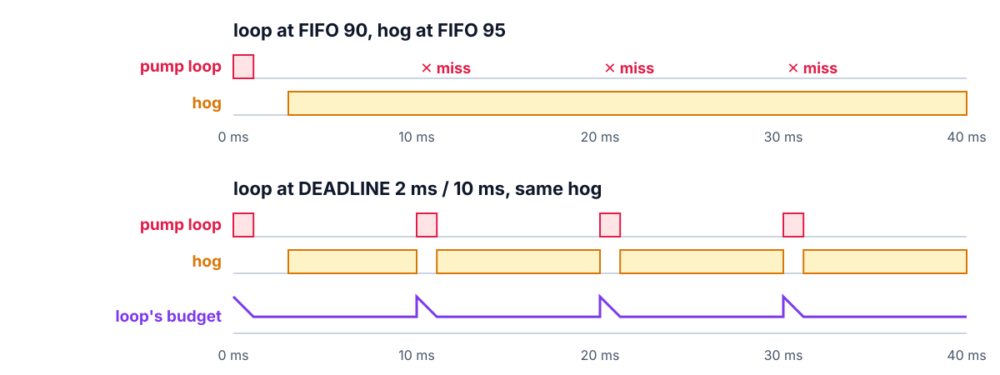

<!--
theme: course
paginate: true
title: SCHED_DEADLINE
math: mathjax
style: |
  section { --course: #0d9488; }
-->

<!-- _class: lead -->
<!-- _paginate: false -->

# From priorities to contracts

**Week 11** · servers, reservation, CBS → `SCHED_DEADLINE`

One process at FIFO 95, a typo or an installer default, and the pump loop gets no CPU. Forever.

<!--
0:00–2:00. On the node we reviewed every task. The Hub runs a GUI toolkit and a
network stack we didn't write.
-->

---

<!-- _class: agenda -->

## Today

1. **Why priorities stop being enough**
2. **Reservation**: the Constant Bandwidth Server
3. **`SCHED_DEADLINE`**: the CBS, in the Linux kernel
4. **Lab**: starve the loop, then sign the contract

Goal: turn a measured loop into a runtime/period contract with a defended margin.

<!--
2:00–3:00. Reading: Buttazzo §6.9.1–6.9.4 (CBS), §9.3. The rest of chs. 5–6 gets
one intuition sentence: other servers exist.
-->

---

<!-- _class: s1 -->
<!-- _header: 1 · Priorities -->

## A priority is a relative claim

- It guarantees you beat whoever is below you, not **how much** CPU you get
- On the node that was enough: all the code was ours, and reviewed
- On the Hub, the GUI and the routing stack are someone else's code

<!--
3:00–6:00. Question for the room: whose code review protects you here? Nobody's:
that's the point.
-->

---

<!-- _class: s2 figure -->
<!-- _header: 2 · Reservation -->

## The same hog, two policies

<!--
6:00–11:00. Top: the hog at FIFO 95 starts at 3 ms and never stops; the loop at 90
never runs again. No bug, just arithmetic. Bottom: the loop holds a reservation of
2 ms every 10 ms. Deadline tasks run before any FIFO task, so the loop gets its
1.1 ms each period and the hog gets everything else. The purple line is the loop's
budget: spent while it runs, recharged each period.
-->

---

<!-- _class: s2 -->
<!-- _header: 2 · Reservation -->

## The Constant Bandwidth Server, in three rules

1. A job arrives at an idle server: keep the deadline if the leftover budget fits; else deadline = now + $T_s$, budget = $Q_s$
2. Running spends budget
3. Budget at zero: recharge $Q_s$, deadline += $T_s$

EDF picks among servers. Isolation: $U_s = Q_s/T_s$, whatever else runs.

<!--
11:00–17:00. Buttazzo Fig. 6.15 and Theorem 6.8. The second result: inside the
reservation, R_i ≈ C_i / U_s. Under SCHED_DEADLINE, rule 3 throttles the task until
its next period: a hard reservation.
-->

---

<!-- _class: s2 question -->
<!-- _header: 2 · Reservation -->

## The loop asks for 1 ms every 10 ms but needs 1.1 ms. Who suffers?

1. The hog: DEADLINE always wins
2. The loop: it's throttled until the next period
3. Nobody: the kernel lends it the extra 0.1 ms
4. The GUI: it loses its slice

<!--
17:00–19:00. Answer: 2. Misconception to anticipate: "DEADLINE is just a very high
priority". It is a contract, and it binds you too. Undersizing Q_s hurts you, not
the neighbors: hence the lab's margin question.
-->

---

<!-- _class: s3 -->
<!-- _header: 3 · SCHED_DEADLINE -->

## Signing the contract

- `sched_setattr()` with runtime ≤ deadline ≤ period, in ns
- **Admission control**: the kernel refuses a contract that would oversubscribe the CPUs (week 6's test, at syscall time)
- `chrt -d --sched-runtime … --sched-period … 0 ./pump_loop` from the shell

<!--
19:00–24:00. Ask: the loop measured C ≈ 1.1 ms per 10 ms. What runtime do you
request, and what's the argument for the cushion? (Measured high-water mark under
load, plus margin for what the measurement may have missed: week 9.) The default
limit leaves 5 % of each CPU to non-RT work (sched_rt_runtime_us).
-->

---

<!-- _class: s3 -->
<!-- _header: What about FreeRTOS? -->

## What about FreeRTOS?

- No reservations in FreeRTOS or Zephyr: priorities only
- Defensible on an MCU: all the code is yours, review replaces contracts
- Once third-party code shares the CPU, that defense is gone: that is why the Hub is Linux, and why this mechanism lives there

<!--
24:00–26:00.
-->

---

<!-- _class: takeaway -->

## The one thing to remember

> A priority says who goes first. A reservation says how much you get, no matter who else is running.

<!--
26:00–27:00.
-->

---

<!-- _class: s4 -->
<!-- _header: 4 · Lab -->

## Today in the lab

| Predict now | Then measure |
|---|---|
| Misses, FIFO 90, quiet | 5 min, miss counter + GPIO |
| Misses, FIFO 90 + FIFO 95 hog | the freeze, captured |
| Misses, DEADLINE 2/10 + the same hog | misses = 0? |

<!--
27:00–32:00. Buttazzo ch. 12's ptask pattern nearly verbatim. The two sentences
connecting runtime/period to U_s = Q_s/T_s go straight into the RET.
-->

---

## References

- Buttazzo, §6.9.1–6.9.4 (CBS, Fig. 6.15, Theorem 6.8), §9.3; ch. 12 (the ptask pattern)
- Linux kernel docs: *Deadline Task Scheduling*
- `man 7 sched`, `man 2 sched_setattr`, `man 1 chrt`

<!--
32:00–40:00. Questions, then the lab.
-->
