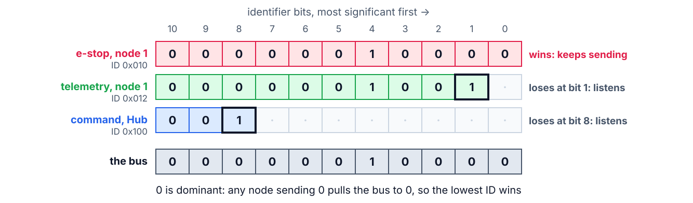
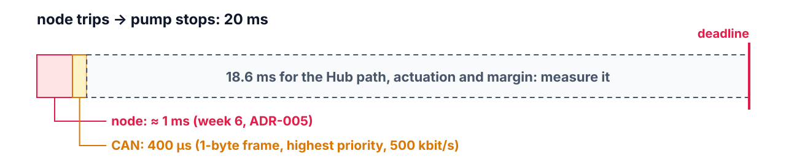

<!--
theme: course
paginate: true
title: CAN
math: mathjax
style: |
  section { --course: #0d9488; }
-->

<!-- _class: lead -->
<!-- _paginate: false -->

# CAN: the bus as a scheduled resource

**Week 12** · one deadline across two cores, a bus and Linux

A node trips its e-stop. How long does the pump keep pushing water?

<!--
0:00–2:00. Edwin's question, from the scenario: the Hub must stop the pump within
20 ms of a node's e-stop. Until now every deadline lived on one CPU. This one
crosses the node's two cores, a wire and the Hub, and each hop has its own
scheduler.
-->

---

<!-- _class: agenda -->

## Today

1. **Why CAN**: the field bus of farm machinery
2. **Arbitration**: fixed priorities, on a wire
3. **Bus RTA**: frame time and worst-case response
4. **End to end**: one budget, four schedulers
5. **Lab**: checkpoint 1

Goal: give the e-stop frame a response time, and find where the rest of 20 ms goes.

<!--
2:00–3:00. The reading is Davis et al. 2007: the model, the frame-time formula and
the sufficient test. READINGS.md has the two formulas.
-->

---

<!-- _class: s1 -->
<!-- _header: 1 · Why CAN -->

## Why not a UART, or Wi-Fi?

| | UART | Wi-Fi | CAN |
|---|---|---|---|
| Nodes on one link | 2 | many | many |
| Who talks when | wiring | contention, retries | **priority, bit by bit** |
| Worst case | bounded | unbounded | **analyzable** |
| Next to pumps and motors | single-ended | radio | differential pair |

<!--
3:00–6:00. ISOBUS (ISO 11783), the standard tractors and implements use to talk to
each other, runs on CAN, as do most cars built since the 1990s. Differential signalling survives
the electrical noise of a pump station; a 2.4 GHz link next to a metal tank does
not promise anything. Point at the "worst case" row: it is the reason this course
cares.
-->

---

<!-- _class: s2 figure -->
<!-- _header: 2 · Arbitration -->

## Three nodes start at once; the lowest ID wins

<!--
6:00–10:00. Every node transmits and listens at the same time. A node that sends
a recessive 1 but reads a dominant 0 knows someone more important is talking and
stops; the winner never notices. No collision, no lost time: the bus is a
fixed-priority scheduler, and the ID is the priority. Losers retry after the frame.
-->

---

<!-- _class: s2 -->
<!-- _header: 2 · Arbitration -->

## Week 6, on a wire

- The ID is a **fixed priority**: assign IDs in deadline order (DM, week 6)
- A frame on the wire **can't be preempted**: the most urgent frame may wait one frame
- That wait is **blocking**, the $B_i$ of week 6, without any mutex

<!--
10:00–12:00. Same theory, one new twist: non-preemption. In week 6 blocking came
from a lower-priority thread holding a lock; here it comes from a lower-priority
frame already being transmitted.
-->

---

<!-- _class: s2 question -->
<!-- _header: 2 · Arbitration -->

## The e-stop frame has the lowest ID on the bus. Its worst wait before it starts?

1. Zero: it always wins arbitration
2. One longest frame: one may already be on the wire
3. Every higher-priority frame, once each
4. The bus period, until its slot comes round

<!--
12:00–14:00. Vote, pairs, vote. Answer: 2. 1 forgets non-preemption: arbitration
only happens between frames. 3: there are none above it. 4 describes a
time-triggered bus (TDMA), not CAN.
-->

---

<!-- _class: s3 -->
<!-- _header: 3 · Bus RTA -->

## Frame time, worst case

$$C_m = (55 + 10\,s_m)\,\tau_{bit} \qquad \text{11-bit IDs, } s_m \text{ data bytes}$$

| Data bytes | Bits | At 500 kbit/s |
|---|---|---|
| 1 | 65 | 130 µs |
| 8 | 135 | 270 µs |

<!--
14:00–16:00. The 55 + 10 s includes the worst-case stuff bits: after five equal
bits the controller inserts an opposite one, so a frame's length depends on its
content. The formula takes the worst content.
-->

---

<!-- _class: s3 -->
<!-- _header: 3 · Bus RTA -->

## Response time on the bus

$$R_m = J_m + w_m + C_m \qquad w_m = B_{max} + \sum_{k \in hp(m)} \left\lceil \frac{w_m + J_k + \tau_{bit}}{T_k} \right\rceil C_k$$

- Iterate $w_m$ like week 6's RTA; $B_{max}$ is the longest frame on the bus
- e-stop, 1 byte, highest priority: $R = 0 + 270 + 130 = 400$ µs

<!--
16:00–19:00. J_m is queuing jitter: how late, after its event, the frame is queued.
The τ_bit term: a higher-priority frame queued within one bit time of arbitration
still wins it. This is the sufficient test of Davis et
al.: they showed in 2007 that the analysis everyone had used since 1994 was
optimistic for low-priority frames, which is why the blocking term is B_max. The
bus utilization is ΣC_k/T_k, as for tasks.
-->

---

<!-- _class: s4 figure -->
<!-- _header: 4 · End to end -->

## 20 ms, four schedulers

<!--
19:00–22:00. The node and the bus are already small and analyzed: detection on
APPCPU, the IPM hop to PROCPU (week 8 measured it), the frame. Everything else is
the Hub: the MCP2515 raises an interrupt, its handler reads the frame over
SPI, the interlock thread wakes, the pump output switches. Each step has a
priority, and that is the next question.
-->

---

<!-- _class: s4 question -->
<!-- _header: 4 · End to end -->

## Interlock at FIFO 80, GUI at FIFO 60, CAN interrupt thread at its default 50. Who can delay the e-stop?

1. Nobody: the interlock has the highest priority
2. The GUI: it outranks the thread that reads the frame
3. The bus: arbitration is unbounded
4. The SPI clock

<!--
22:00–24:00. Answer: 2. Under PREEMPT_RT the CAN controller's interrupt handler is
a thread, SCHED_FIFO 50 by default; a GUI busy at 60 starves it, and the interlock
never sees the frame. A path is as urgent as its least urgent hop: week 6's
inversion, along a chain. Fix: chrt the IRQ thread above the GUI (week 10's
recipe has the commands). 3 contradicts the last two slides; 4 is microseconds.
-->

---

<!-- _class: s4 -->
<!-- _header: What about FreeRTOS? -->

## What about FreeRTOS?

- The CAN driver comes with the vendor SDK (ESP-IDF's TWAI driver); Zephyr's is the same API on every chip
- The frames, the IDs and the bus RTA don't change: the wire doesn't know the kernel

<!--
24:00–25:00.
-->

---

<!-- _class: takeaway -->

## The one thing to remember

> An end-to-end deadline is only as urgent as its least urgent hop: the thread, the frame ID, the interrupt thread, the interlock. Give each a priority that matches the deadline.

<!--
25:00–26:00.
-->

---

<!-- _class: s5 -->
<!-- _header: 5 · Lab -->

## Checkpoint 1, and today's predictions

| Predict now | Then measure |
|---|---|
| Bus load with your frame plan | `canbusload` on the Hub |
| e-stop frame's response on the bus | node GPIO → end of frame on the CTX pin (analyzer, CAN decoder) |
| The Hub path: frame in → pump GPIO | the analyzer, at checkpoint 2 |

The CAN link (SOP-12) and ADR-P5 with the bus RTA are part of checkpoint 1.

<!--
26:00–32:00. Bring the SOP-12 wiring table up on the screen. Common first-day
failures: missing termination (measure 60 Ω), TX/RX swapped, the sample left in
loopback mode.
-->

---

## References

- R. I. Davis, A. Burns, R. J. Bril, J. J. Lukkien, "Controller Area Network (CAN) schedulability analysis: refuted, revisited and revised", *Real-Time Systems* 35, 2007
- ISO 11898-1 (CAN); ISO 11783 (ISOBUS) for where it runs on a farm
- Linux kernel docs: *SocketCAN*; Zephyr docs: *Controller Area Network (CAN)*
- [SOP-12](../sops/sop12_can.md): wiring, the Pi's overlay, the node's overlay

<!--
32:00–40:00. Questions, then the checkpoint.
-->
