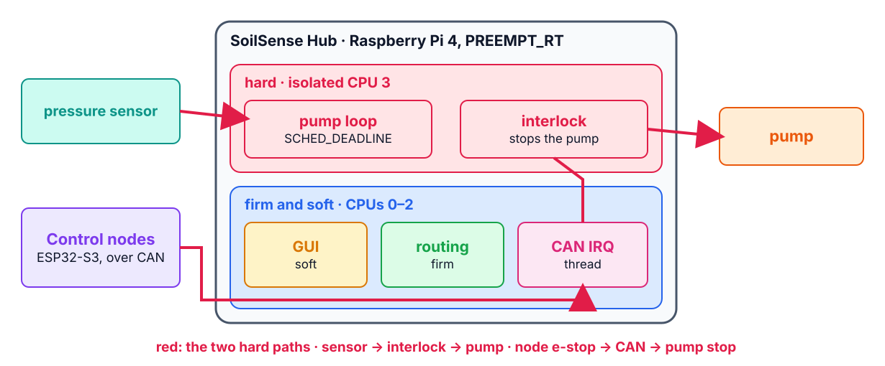
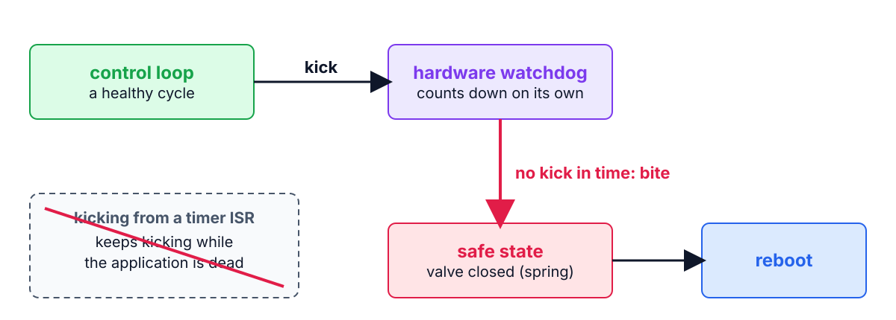

<!--
theme: course
paginate: true
title: Mixed criticality and safety
style: |
  section { --course: #0d9488; }
-->

<!-- _class: lead -->
<!-- _paginate: false -->

# Mixed criticality and safety

**Week 13** · the SoilSense Hub kickoff

One box, three personalities: it controls the pumps, serves a human, and moves data.

<!--
0:00–2:00. A mixed-criticality system is designed before typing, or debugged
forever. Today nobody codes: today the team decides, in writing.
-->

---

<!-- _class: agenda -->

## Today

1. **Mixed criticality**: what would force an MCU
2. **Safety**: the safe state and the watchdog chain
3. **The standards**: what IEC 61508 and DO-178C regulate
4. **The project**: ADRs today, numbers at every checkpoint

Goal: argue a Linux-vs-MCU partition with measured tails, and specify a watchdog that can't be fooled.

<!--
2:00–3:00. Reading: Buttazzo ch. 11: §11.2, §11.3, §11.5.2.
-->

---

<!-- _class: s1 figure -->
<!-- _header: 1 · Mixed criticality -->

## The Hub: hard paths on an isolated core, the rest around them

<!--
3:00–9:00. The defining risk: the low-criticality load hurting the
high-criticality tail. The two red paths are hard: the pressure sensor through the
interlock to the pump, and a node's e-stop through CAN to the pump stop (20 ms).
The CAN interrupt thread sits outside the isolated core but on a hard path: next
week's talk is about exactly that.
-->

---

<!-- _class: s1 -->
<!-- _header: 1 · Mixed criticality -->

## ADR-P1: what stays in Linux, what would force an MCU

- Not taste: two numbers already in your RET
- Week 9: an MCU loop's tail, **µs**
- Weeks 10–12: RT Linux, isolated, **tens of µs**
- Compare each against its requirement's deadline

<!--
9:00–12:00. Write the week-9 and week-12 tails next to each band's deadline on the
board.
-->

---

<!-- _class: s1 question -->
<!-- _header: 1 · Mixed criticality -->

## Which change would move the pump loop off Linux, onto an MCU?

1. A deadline of 100 µs instead of 10 ms
2. A GUI twice as heavy
3. A second Control node on the bus
4. A faster Raspberry Pi

<!--
12:00–14:00. Answer: 1. A deadline near the isolated Linux tail leaves no margin;
that is the ADR's sensitivity. 2 is what isolation is for. 3 loads the bus, not
the loop. 4 moves the mean, not necessarily the tail.
-->

---

<!-- _class: s2 figure -->
<!-- _header: 2 · Safety -->

## Who kicks, who bites, what a bite does

<!--
14:00–20:00. A real-time guarantee covers the system working; safety covers it
failing. The safe state is declared and reachable without software: the valve
closes on a spring, not on hope. The loop kicks only after a healthy cycle; a
hardware timer bites; the bite drives the safe state, then maybe reboots.
Checkpoint 2 kills the loop live and the valve must close on its own.
Misconception to anticipate: "the watchdog is a debug convenience". It is the
last control loop. Kicking it from a timer ISR, which keeps running while the
application is dead, is the classic way to neuter it; Samuel looks for exactly
that in ADR-P4.
-->

---

<!-- _class: s2 question -->
<!-- _header: 2 · Safety -->

## The pump loop's thread hangs. The watchdog is kicked from a 100 ms timer callback. What happens?

1. The watchdog bites and the valve closes
2. Nothing: the timer keeps kicking
3. The kernel restarts the thread
4. The GUI shows an alarm

<!--
20:00–22:00. Answer: 2, and that is the bug. The kick must prove the loop
completed a healthy cycle, so the loop itself kicks, or a supervisor kicks only
when every critical thread has checked in.
-->

---

<!-- _class: s3 -->
<!-- _header: 3 · The standards -->

## Two names from job postings

| | Regulates | Its spine |
|---|---|---|
| **IEC 61508** | electrical and electronic safety functions | hazard → SIL → required rigor |
| **DO-178C** | software in airborne systems | evidence and traceability, by criticality level |

Both trace requirements to evidence: the RTM you have kept since week 2 is the entry-level version.

<!--
22:00–26:00. IEC 61508 is the industrial and medical world (its sector standards
derive from it); DO-178C is avionics.
-->

---

<!-- _class: s4 -->
<!-- _header: 4 · The project -->

## How the project runs

| Week | Milestone | Passes with… |
|---|---|---|
| 13 | Kickoff | ADR-P1–P4 defended with evidence; ADR-P5 (the bus) drafted |
| 14 | Checkpoint 1 | the hard loop under load, misses = 0; CAN link up; bus RTA |
| 15 | Checkpoint 2 | GUI + routing; the e2e budget measured; the watchdog bites live |
| 16 | Demo day | live demo, final RET, honest postmortem |

<!--
26:00–30:00. Checkpoint targets are numbers with a load condition, not
"progress". The kernel comparison retires undefeated: ADR-P1's MCU option can be
Zephyr or FreeRTOS; the partitioning argument is kernel-agnostic.
-->

---

<!-- _class: takeaway -->

## The one thing to remember

> Design the failure before the feature: a declared safe state, reachable without software, and a watchdog only a healthy loop can feed.

<!--
30:00–31:00.
-->

---

<!-- _header: Kickoff -->

## Today, instead of a lab

- The architecture diagram: processes, policies, CPUs, the CAN link, the hard paths in red
- ADR-P1–P4 drafted and defended before Samuel; ADR-P5 started
- Both checkpoint targets in the RET, as numbers with their load condition

<!--
31:00–35:00. Then the teams work; Samuel visits each one.
-->

---

## References

- Buttazzo, ch. 11: §11.2, §11.3, §11.5.2 (the robot's task table in §11.4 mirrors the node's)
- IEC 61508 (functional safety), DO-178C (airborne software): overviews only
- Lab 13 guide: the ADRs, the milestones, the rubric

<!--
35:00–40:00.
-->
